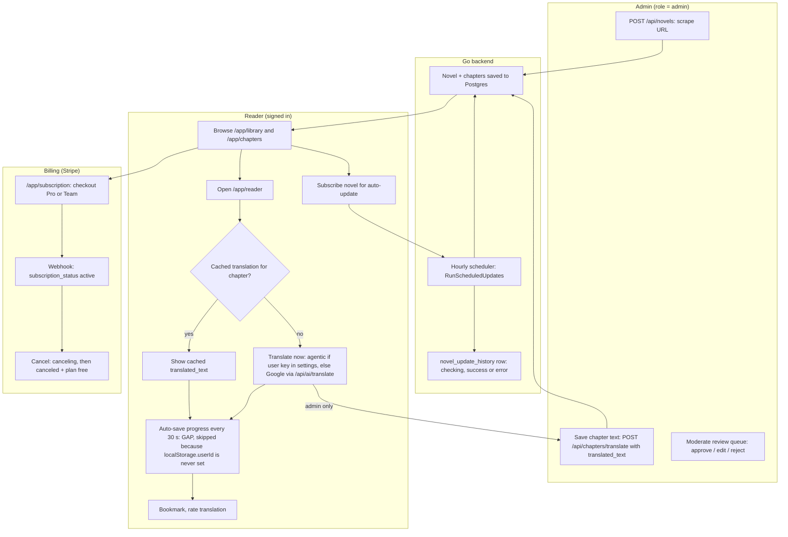
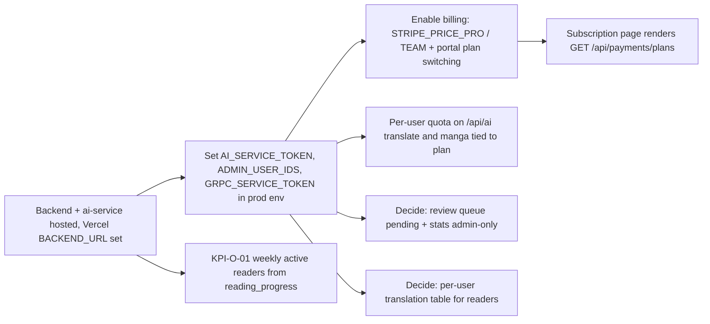

# 01 — Business process (As-Is / To-Be)

ภาพนี้วาดจากโค้ดที่ commit `74cf7cb` (origin/main, 2026-10-24) ร่วมกับ central flow pack
[`bookreading-ui/01-business-swimlane.md`](https://github.com/bookchaowalit/architecture-docs/blob/main/docs/architecture/flows/bookreading-ui/01-business-swimlane.md)
(reused เป็นภาพตั้งต้น แต่ pack นั้น pin ที่ `6fd8737` เดือน 2026-08 ก่อน pass 7–11 จึงมีจุดที่ไม่ตรงกับโค้ดปัจจุบัน ดูหัวข้อ "ต่างจาก central pack")

## As-Is (จากโค้ดวันนี้)

ธุรกิจมีสามงาน: (1) admin เติม catalog นิยายด้วยการ scrape, (2) ผู้อ่านเปิดอ่านและแปลบท (AI แปลเมื่อผู้อ่านกดเลือกแท็บไทย/side-by-side หรือปุ่มแปล — เปิดบทครั้งแรกแสดงต้นฉบับ `viewMode = 'original'`), (3) ระบบ subscription ของ Stripe
และมีงานเบื้องหลังหนึ่งงานคือ scheduler ทุก 60 นาทีที่ re-scrape นิยายที่ผู้ใช้กด subscribe ไว้

Sources: `backend/internal/delivery/http/server.go`, `backend/internal/delivery/http/handler.go` (`ScrapeNovel`, `TranslateChapter`),
`backend/cmd/main.go` (scheduler 60 นาที), `backend/internal/scheduler/novel_update.go`, `backend/internal/usecase/novel_update_usecase.go`,
`frontend/src/app/app/reader/page.tsx` (cached → agentic ถ้ามี key ใน settings, ไม่งั้น google; admin-only save), `frontend/src/components/ReadingProgressTracker.tsx` (30 s), `frontend/src/hooks/useReadingProgress.ts` (`saveCurrentProgress` returns early when `localStorage.userId` is missing; login/register store only `user` and `isLoggedIn`),
`backend/internal/delivery/http/payment_handler.go`, `docs/UPGRADE-PLAN.md` (pass 2–4, 10)

### Review queue ใน As-Is

ai-service มี review queue (`pending → approved / edited / rejected`) แต่ item เข้าคิวได้ทางเดียวคือ `POST /translate/pipeline` ที่ตั้ง `add_to_review_queue`
และ path นี้ **ไม่อยู่ใน allow-list ของ `/api/ai` proxy** และ Go `aiservice` client ก็ไม่เรียก ดังนั้นในเส้นทางของแอปวันนี้ คิวจะว่างเสมอ
(admin เปิด `/admin/review` ได้ แต่ไม่มีอะไรให้ review) และผู้อ่านเห็นคำแปลของ AI โดยไม่ผ่าน review

Sources: `ai-service/main.py` (`translate_with_pipeline`, `/review/*`), `backend/internal/delivery/http/ai_proxy_handler.go` (`aiProxyRoutes`),
`backend/internal/infrastructure/aiservice/client.go`, `frontend/src/app/admin/review/page.tsx`

### Production วันนี้

`https://bookreading.bookchaowalit.com` เป็น Vercel project `bookreading-frontend` (frontend อย่างเดียว) ทดสอบ 2026-11-03:
`/build-info` ตอบ commit `74cf7cb` แต่ `/api/health` และ `/api/novels` ตอบ `502 DNS_HOSTNAME_NOT_FOUND` สำหรับ raw `fetch` ที่ผ่าน rewrite `/api/*` ซึ่งชี้ไป
`BACKEND_URL` (default `http://backend:8080`) ที่ไม่มีบน Vercel ดังนั้นใน production ทุก flow ที่ต้องใช้ backend (login, library, translate, billing) ใช้ไม่ได้
เหลือเฉพาะหน้า marketing — ดู [16-deployment.md](./16-deployment.md)

Sources: `frontend/next.config.ts`, `frontend/src/app/build-info/route.ts`, `specs/001-next16-shared-ci-sentry/spec.md` (Deploy note)

## ต่างจาก central pack (bookreading-ui, pin `6fd8737`)

| central pack บอก | โค้ด `74cf7cb` |
|---|---|
| "chapter อยู่ใน library ได้เมื่อผ่าน review (`approved`)" | reader ไม่อ่านสถานะ review เลย; แสดง cached translation หรือแปลสด (`reader/page.tsx`) |
| scraper ส่ง chapter เข้า AI แปล + ให้คะแนน → review | scheduler แค่ re-scrape (`CheckForUpdates`), ไม่แปล ไม่เข้าคิว |
| `/review/*` ไม่มี auth, frontend เรียก ai-service ตรง | ผ่าน `/api/ai` + session; approve/edit/reject ต้อง admin (pass 7–8) |
| ไม่มี role | `users.role` user/admin (migration 009) |

## To-Be

To-Be เอาเฉพาะที่เขียนไว้ใน `docs/UPGRADE-PLAN.md`, `specs/` และ `docs/measurement/KPI-PLAN.md`:

Sources: `docs/UPGRADE-PLAN.md` (Backlog P0/P1), `docs/measurement/KPI-PLAN.md`, `specs/001-next16-shared-ci-sentry/spec.md`

## Open questions

- backend และ ai-service จะ host ที่ไหน (Railway / Docker host)? ไม่มีไฟล์ใดใน repo บอก (`specs/001` เขียนว่า "not recorded here")
- review queue ควรถูกป้อนจาก flow ไหน (`/translate/pipeline` ไม่ถูก proxy) หรือควรเอาออก?
- To-Be ของ "approved translation เท่านั้นที่ผู้อ่านเห็น" (ตาม central pack) เป็นความตั้งใจของ owner หรือไม่
