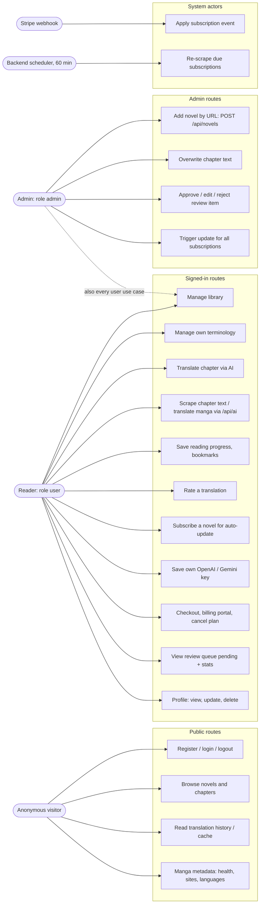

# 02 — Use cases

Actor มาจากระดับสิทธิ์จริงในโค้ด: `routes_access_test.go` แบ่ง route เป็น public / authenticated / admin และ `users.role` มีค่า `user` หรือ `admin` (migration 009)
บวก actor ภายนอกสองตัว: Stripe (webhook ที่ลงลายเซ็น) และ scheduler ภายใน backend

Sources: `backend/internal/delivery/http/server.go`, `backend/internal/delivery/http/ai_proxy_handler.go` (`aiProxyRoutes`, `public`/`admin` flags),
`backend/internal/delivery/http/routes_access_test.go`, `backend/internal/domain/model.go` (`RoleUser`, `RoleAdmin`),
`database/migrations/009_add_users_role.up.sql`, `backend/cmd/main.go`, `docs/API.md`

## หมายเหตุ

- admin ได้มาจาก `ADMIN_USER_IDS` ตอน startup (`BootstrapAdmins`) หรือ SQL `UPDATE` เท่านั้น ไม่มี UI ให้ตั้ง role (`server.go`, `docs/API.md`)
- UC14 (ดู queue) เป็น authenticated ไม่ใช่ admin — `docs/UPGRADE-PLAN.md` P1 ยังเปิดเป็นคำถามว่าจะทำเป็น admin-only หรือไม่
- frontend ซ่อนปุ่ม moderation จาก non-admin ด้วย `useIsAdmin` แต่ตัวบังคับจริงคือ backend (`frontend/src/hooks/useIsAdmin.ts`)
- gRPC `BookReadingService` มีใน proto แต่ `cmd/main.go` ไม่ได้ start จึงไม่นับเป็น use case (`backend/proto/bookreading.proto`, `backend/cmd/main.go`)

Central pack ที่เกี่ยวข้อง: [06-authz-decision.md](https://github.com/bookchaowalit/architecture-docs/blob/main/docs/architecture/flows/bookreading-ui/06-authz-decision.md)
(เขียนก่อนมี role — ข้อ "no `UserRole`-style enum" และ "/review/* ไม่มี auth" ไม่ตรงกับโค้ดปัจจุบันแล้ว)

## Open questions

- Team plan (Stripe `STRIPE_PRICE_TEAM`) มี actor "team member" หรือไม่? โค้ดไม่มีตาราง team/member ใด ๆ
