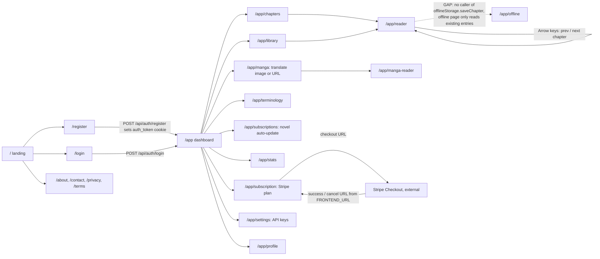
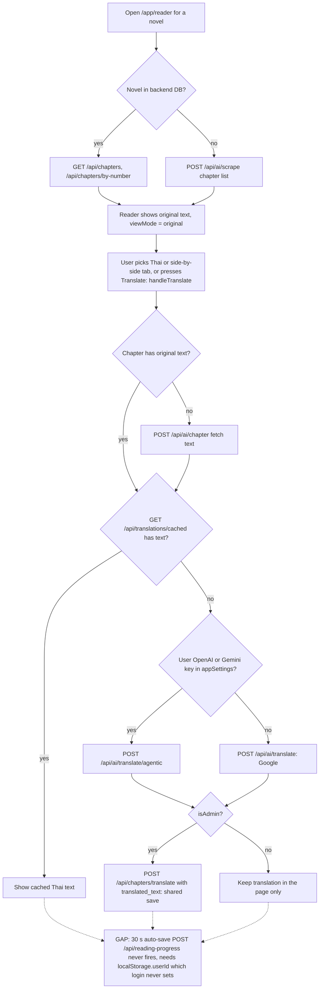
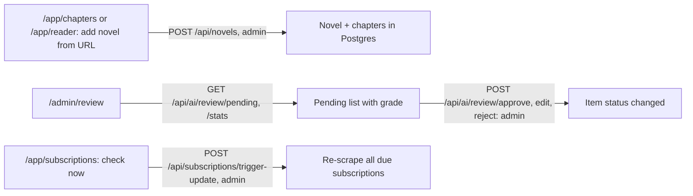

# 03 — User flows

Route จาก `frontend/src/app/**/page.tsx` (21 หน้า + `/build-info`) ภาพหน้าจอ/scene ของ reader และ reviewer มีอยู่แล้วใน central pack
[02-operator-storyboard.md](https://github.com/bookchaowalit/architecture-docs/blob/main/docs/architecture/flows/bookreading-ui/02-operator-storyboard.md) (reused)
ไฟล์นี้เพิ่ม flow ต่อ role ตามโค้ดปัจจุบัน

## Visitor → reader

`/app/*` ใช้ guard ฝั่ง client: `app/app/layout.tsx` ดู `localStorage.isLoggedIn` ถ้าไม่มี → `/login` (session จริงคือ cookie `auth_token` ที่ backend ตรวจ)

Sources: `frontend/src/app/` (ทุก `page.tsx`), `frontend/src/app/app/layout.tsx`, `frontend/src/app/login/page.tsx`, `frontend/src/app/register/page.tsx`,
`frontend/src/lib/offline-storage.ts` (`BookReadingOfflineDB`), `frontend/src/app/app/subscription/page.tsx`, `backend/internal/delivery/http/payment_handler.go` (`frontendURL`)

## Reader: เปิดบทและแปล

Sources: `frontend/src/app/app/reader/page.tsx`, `frontend/src/lib/api.ts`, `frontend/src/components/ReadingProgressTracker.tsx`,
`frontend/src/hooks/useReadingProgress.ts`, `backend/internal/delivery/http/handler.go` (`TranslateChapter`)

## Admin: เพิ่มนิยายและ moderate

Sources: `frontend/src/app/admin/review/page.tsx`, `frontend/src/hooks/useIsAdmin.ts`, `frontend/src/app/app/subscriptions/page.tsx`,
`backend/internal/delivery/http/server.go`, `backend/internal/delivery/http/ai_proxy_handler.go`, `docs/UPGRADE-PLAN.md` (pass 9–10)

## ช่องว่างที่เห็นจากโค้ด

- `/admin/review` อยู่นอก `app/app/layout.tsx` จึงไม่มี client guard; ข้อมูลยังถูกปิดด้วย session ที่ backend
- `new-api.ts` เรียก `GET /api/feedback/history` แต่ backend ไม่มี route นี้ (`server.go` มีแค่ `/api/feedback`, `/chapter`, `/quality-score`)
- ใน production ทุกลูกศรที่ไป `/api/*` ตอบ 502 วันนี้ (ไม่มี backend) — ดู [16-deployment.md](./16-deployment.md)

## Open questions

- `/app/offline` ใช้ได้จริงไหมเมื่อไม่มี service worker? ไม่พบไฟล์ service worker ใน `frontend/` (มีแค่ IndexedDB)
