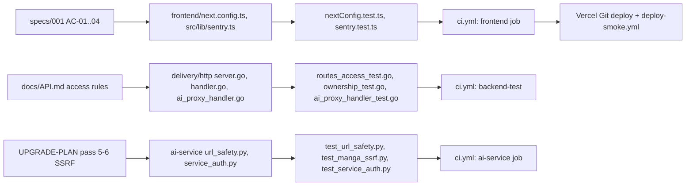

# 04 — Traceability (RTM)

Requirement มาจากเอกสารที่มีจริงเท่านั้น: `specs/001-next16-shared-ci-sentry/spec.md` (AC-01…AC-04), `PRODUCT.md` (auth contract ฝั่ง frontend),
`docs/API.md` (access rules) และ `docs/UPGRADE-PLAN.md` (pass 1–11 ที่ระบุว่า done) ไม่มี ID ทางการสำหรับข้อที่ไม่ใช่ SPEC-001
จึงตั้ง ID ชั่วคราว `REQ-xx` ในตารางนี้ ส่วน UAT ของ central pack อยู่ที่
[08-uat-traceability.md](https://github.com/bookchaowalit/architecture-docs/blob/main/docs/architecture/flows/bookreading-ui/08-uat-traceability.md) (reused สำหรับ BR-F1…BR-A4; BR-A4 "/review/* เปิดโล่ง" ถูกปิดแล้วใน pass 7–8)

Sources: ไฟล์ทั้งหมดในตารางด้านล่าง

| ID | Requirement (ที่มา) | Code module | Test file | Release / workflow |
|---|---|---|---|---|
| AC-01 | `images.remotePatterns`, ไม่ซ่อน type error, proxy `/api/*` ไป backend (specs/001) | `frontend/next.config.ts` | `frontend/src/lib/__tests__/nextConfig.test.ts` | `ci.yml` frontend → Vercel |
| AC-02 | Sentry ปิดเมื่อไม่มี DSN, errors only, scrub request/user/breadcrumbs (specs/001) | `frontend/src/lib/sentry.ts`, `src/instrumentation*.ts` | `frontend/src/lib/__tests__/sentry.test.ts` | `ci.yml` frontend → Vercel |
| AC-03 | พฤติกรรมเดิมไม่เปลี่ยนหลัง upgrade (specs/001) | ทั้ง frontend | vitest ทั้งชุด, `frontend/e2e/landing.spec.ts` (ไม่รันใน CI) | `ci.yml` frontend |
| AC-04 | security scan ไม่มีช่องโหว่ที่ยังไม่ review (specs/001) | `*/osv-scanner.toml` | — (scanner) | `ci.yml` security |
| REQ-01 | axios `withCredentials: true`, Bearer เฉพาะเมื่อมี `localStorage.token` (PRODUCT.md) | `frontend/src/lib/api.ts` | `frontend/src/lib/__tests__/api.test.ts` | `ci.yml` frontend |
| REQ-02 | ข้อมูลรายผู้ใช้ผูกกับ session, `user_id` อื่น → 403 (docs/API.md, pass 9) | `backend/internal/delivery/http/handler.go` (`sessionUserID`) | `backend/internal/delivery/http/ownership_test.go` | `ci.yml` backend-test |
| REQ-03 | ทุก route มีระดับสิทธิ์ที่ประกาศ; catalog write = admin (pass 10) | `backend/internal/delivery/http/server.go` | `backend/internal/delivery/http/routes_access_test.go` | `ci.yml` backend-test |
| REQ-04 | browser ไป ai-service ผ่าน `/api/ai` เท่านั้น, allow-list, body cap (pass 7) | `backend/internal/delivery/http/ai_proxy_handler.go`, `infrastructure/aiservice/client.go` | `ai_proxy_handler_test.go`, `aiservice/client_test.go` | `ci.yml` backend-test |
| REQ-05 | review approve/edit/reject = admin (pass 8) | `ai_proxy_handler.go`, `handler.go` (`AdminMiddleware`) | `routes_access_test.go` (`TestAIProxyRouteAccess`), `ai_proxy_handler_test.go` (`TestAIProxyReviewModerationRequiresAdmin`), `frontend/src/app/admin/review/__tests__/ReviewPage.test.tsx` | `ci.yml` |
| REQ-06 | admin bootstrap ด้วย `ADMIN_USER_IDS` ไม่ใช่ email (pass 9) | `backend/internal/delivery/http/server_config.go` (`BootstrapAdmins`) | `server_config_test.go` (`TestBootstrapAdminsNeverPromotesByEmail`), `repository/postgres/user_repository_db_test.go` | `ci.yml` backend-test |
| REQ-07 | Stripe webhook order-safe, ไม่ re-activate ที่ cancel แล้ว (pass 2–3) | `backend/internal/delivery/http/payment_handler.go` | `payment_ordering_test.go`, `payment_subscription_test.go`, `payment_handler_test.go` | `ci.yml` backend-test |
| REQ-08 | Stripe Price ID จาก env, validate ตอน startup (pass 4) | `backend/internal/delivery/http/billing_plans.go` | `billing_plans_test.go` | `ci.yml` backend-test |
| REQ-09 | rate limit 100/10/5 ต่อนาที, trust XFF เฉพาะ `TRUSTED_PROXIES` (README, pass 2) | `backend/internal/middleware/rate_limit.go` | `backend/internal/middleware/rate_limit_test.go` | `ci.yml` backend-test |
| REQ-10 | pagination clamp ก่อนถึง SQL (pass 4) | `backend/internal/domain/pagination.go`, `delivery/grpc/pagination.go` | `usecase/pagination_test.go`, `delivery/grpc/pagination_test.go` | `ci.yml` backend-test |
| REQ-11 | HTTP server timeouts จาก env (pass 8) | `backend/internal/delivery/http/server_config.go` | `server_config_test.go` | `ci.yml` backend-test |
| REQ-12 | gRPC ต้องมี `GRPC_SERVICE_TOKEN` (pass 10) | `backend/internal/delivery/grpc/auth.go` | `backend/internal/delivery/grpc/auth_test.go` | `ci.yml` backend-test (gRPC ไม่ได้ start จริง) |
| REQ-13 | API key เข้ารหัส, legacy plaintext อ่านได้ (pass 1) | `backend/internal/crypto/apikeys.go` | `backend/internal/crypto/apikeys_test.go` | `ci.yml` backend-test |
| REQ-14 | migration chain up/down/up และ rollback ไม่ลบคอลัมน์ของ init.sql (pass 9, 11) | `database/migrations/*.sql`, `database/init.sql` | `scripts/check-migrations.sh` | `ci.yml` backend-test |
| REQ-15 | SSRF guard: allow-list host, ปฏิเสธ private IP, pin IP (pass 5–6) | `ai-service/url_safety.py`, `site_routing.py` | `test_url_safety.py`, `test_manga_ssrf.py`, `test_source_routing.py` | `ci.yml` ai-service |
| REQ-16 | service token บังคับทุก route ยกเว้น public (pass 6) | `ai-service/service_auth.py` | `ai-service/test_service_auth.py` | `ci.yml` ai-service |
| REQ-17 | `/manga/translate-url` ใช้งานได้ (pass 1) | `ai-service/main.py` | `ai-service/test_manga_translate_url.py` | `ci.yml` ai-service |
| REQ-18 | reading streak นับวันตามเวลาท้องถิ่น (pass 4) | `frontend/src/lib/readingStats.ts` | `frontend/src/lib/__tests__/readingStats.test.ts` | `ci.yml` frontend |
| REQ-19 | ป้ายสถานะ subscription ภาษาไทย (pass 4) | `frontend/src/lib/subscriptionStatus.ts` | `frontend/src/lib/__tests__/subscriptionStatus.test.ts` | `ci.yml` frontend |
| REQ-20 | parse error การแปล (Network Error, 504) (pass 1) | `frontend/src/lib/translationErrors.ts` | `frontend/src/lib/__tests__/translationErrors.test.ts` | `ci.yml` frontend |
| REQ-21 | build marker บอก commit สำหรับ smoke test (ADR-0003 D3) | `frontend/src/app/build-info/route.ts` | `frontend/src/app/build-info/route.test.ts`, `scripts/deploy-smoke.sh` | `deploy-smoke.yml` |

## ช่องว่าง

- ไม่มี requirement ID ทางการนอก SPEC-001; ถ้าต้องการ RTM เต็มต้องเขียน spec ย้อนหลังใน `specs/`
- `e2e/landing.spec.ts` มีแต่ไม่มี job ใน `ci.yml` ที่รัน Playwright

## Open questions

- REQ-xx เหล่านี้ควรถูกยกเป็น spec ทางการ (SPEC-002…) หรือไม่
