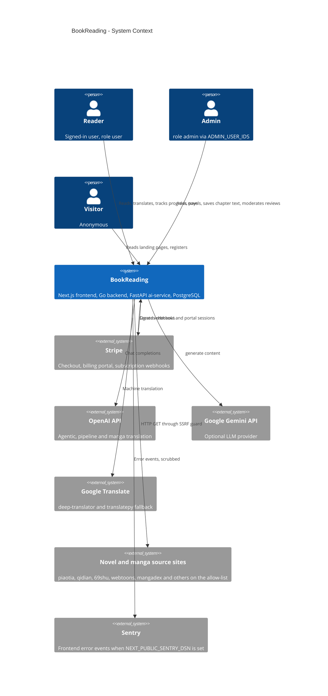

# 05 — C4 Context

ระบบ BookReading มองจากภายนอก: ผู้ใช้สองระดับ (reader, admin) และระบบภายนอกที่โค้ดเรียกจริง

Sources: `backend/internal/delivery/http/payment_handler.go` (stripe-go), `ai-service/agentic_translator.py` (`AsyncOpenAI`, `google.genai`, `GoogleTranslator`),
`ai-service/multi_agent_translator.py`, `ai-service/manga_translator.py`, `ai-service/main.py` (`translatepy`), `ai-service/url_safety.py`,
`ai-service/site_routing.py` (`SUPPORTED_MANGA_DOMAINS`), `frontend/src/lib/sentry.ts`, `backend/internal/domain/model.go` (roles)

## หมายเหตุ

- ผู้ใช้สามารถเก็บ OpenAI/Gemini key ของตัวเองที่ `/api/settings/api-keys` (ตาราง `user_api_keys`) — ใน `/translate/pipeline` มีช่อง `openai_api_key` จาก request
- ไม่พบ email provider, analytics หรือ OAuth provider ในโค้ด

## Open questions

- ใน production ไม่มี backend (ดู [16-deployment.md](./16-deployment.md)) ดังนั้นความสัมพันธ์กับ Stripe/OpenAI/source sites เป็นของ stack ที่รันด้วย `docker-compose.yml` เท่านั้นวันนี้
- Sentry DSN ถูกตั้งใน Vercel แล้วหรือยัง? `KPI-PLAN.md` (2026-10-22) เขียนว่า "DSN not set"
