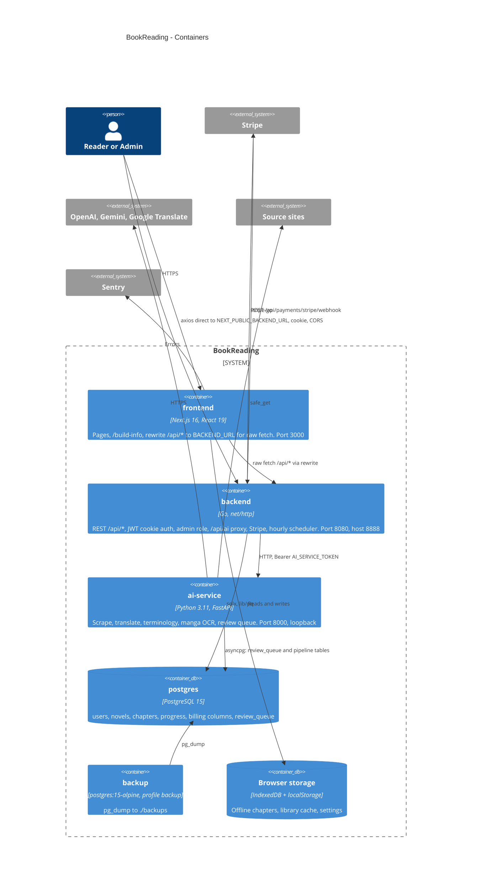

# 06 — C4 Container

Container ตาม `docker-compose.yml` (local / self-host) และ production บน Vercel (frontend อย่างเดียว)

Sources: `docker-compose.yml`, `frontend/next.config.ts`, `frontend/Dockerfile`, `backend/Dockerfile`, `ai-service/Dockerfile`, `backend/cmd/main.go`,
`backend/internal/delivery/http/server.go`, `backend/internal/infrastructure/aiservice/client.go`, `ai-service/db_manager.py`, `ai-service/service_auth.py`,
`frontend/src/lib/offline-storage.ts`, `frontend/src/hooks/useLibrary.ts`, `frontend/src/lib/sentry.ts`

## หมายเหตุ

- gRPC (`:9090`, host `127.0.0.1:9091`) ถูก publish ใน compose แต่ `cmd/main.go` ไม่ start gRPC server (ไม่มี generated stubs, `backend/internal/delivery/grpc/pb/pb.go` เป็น stub) จึงไม่วาดเป็น container
- compose healthcheck ของ backend เรียก `http://localhost:8080/health` แต่ route จริงคือ `/api/health` (`server.go`) — healthcheck นี้น่าจะ fail เสมอ
- ai-service เก็บ review queue และ translation cache ใน memory ด้วย (`multi_agent_translator.review_queue`, `translation_cache.py`) — หายเมื่อ restart

## Open questions

- production host ของ backend / ai-service / postgres (ไม่มีใน repo; Vercel rewrite ชี้ `http://backend:8080` ที่ resolve ไม่ได้)
