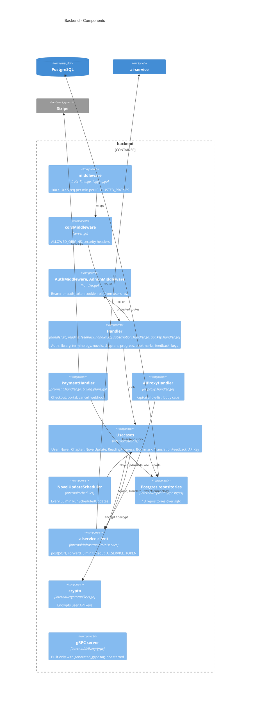
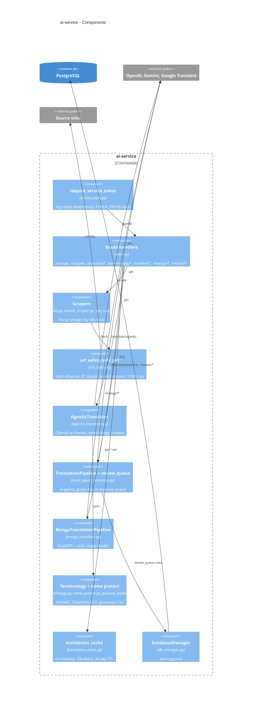

# 07 — C4 Component

## Backend (Go, hexagonal: delivery → usecase → domain ← repository)

Sources: `backend/internal/delivery/http/server.go`, `backend/internal/delivery/http/handler.go`, `backend/internal/delivery/http/ai_proxy_handler.go`,
`backend/internal/delivery/http/payment_handler.go`, `backend/internal/delivery/http/billing_plans.go`, `backend/internal/middleware/rate_limit.go`,
`backend/internal/usecase/*.go`, `backend/internal/repository/postgres/*.go`, `backend/internal/infrastructure/aiservice/client.go`,
`backend/internal/scheduler/novel_update.go`, `backend/internal/crypto/apikeys.go`, `backend/internal/delivery/grpc/server.go`

## ai-service (FastAPI, `main.py` ~3k บรรทัด)

Sources: `ai-service/main.py`, `ai-service/service_auth.py`, `ai-service/url_safety.py`, `ai-service/site_routing.py`, `ai-service/scrapers.py`,
`ai-service/korean_scraper.py`, `ai-service/agentic_translator.py`, `ai-service/multi_agent_translator.py`, `ai-service/manga_translator.py`,
`ai-service/terminology.py`, `ai-service/name_protect.py`, `ai-service/glossary_loader.py`, `ai-service/translation_cache.py`, `ai-service/db_manager.py`

## Frontend components (โดยย่อ)

`src/lib/api.ts` + `src/lib/new-api.ts` (axios client, `/api/ai` path), hooks (`useReadingProgress`, `useLibrary`, `useSubscriptions`, `useTranslationFeedback`, `useIsAdmin`),
providers (`ThemeProvider`, `ToastProvider`), `components/AppShell.tsx` และ `lib/offline-storage.ts`, `lib/epub-generator.ts`, `lib/sentry.ts`
ไม่วาดเป็น C4 แยกเพราะเป็น client-side ล้วน

Sources: `frontend/src/lib/`, `frontend/src/hooks/`, `frontend/src/providers/`, `frontend/src/components/`

## Open questions

- `REFACTORING.md` ใน ai-service เสนอแยก `main.py`; ยังไม่ทำ — owner ต้องการแยกไหม
