# 09 — ERD

Schema จาก `database/migrations/001…010` (source of truth ตาม `docs/UPGRADE-PLAN.md`) บวกตาราง `review_queue` ที่มีเฉพาะใน `database/init.sql`
เส้นทึบ = FK จริงใน SQL, เส้นประ = ความสัมพันธ์ทางตรรกะ (คอลัมน์ `novel_id` ที่ไม่มี FK)

```mermaid
erDiagram
    users {
        uuid id PK
        varchar email UK
        varchar password_hash
        varchar name "nullable since 010"
        varchar avatar_url
        varchar subscription_plan "default free"
        varchar subscription_status "default active"
        varchar role "user or admin, 009"
        varchar stripe_customer_id
        varchar stripe_subscription_id "indexed, 007"
        timestamptz stripe_event_at "008"
        timestamptz created_at
        timestamptz updated_at
    }
    user_library {
        uuid id PK
        uuid user_id FK
        varchar novel_id
        timestamp added_at
    }
    user_terminology {
        uuid id PK
        uuid user_id FK
        varchar novel_id
        varchar original_term
        varchar translation
        varchar term_type
        text description
    }
    user_api_keys {
        uuid id PK
        uuid user_id FK
        varchar provider "openai or gemini"
        varchar key_prefix
        text encrypted_key
    }
    novels {
        varchar id PK
        varchar title
        varchar author
        text description
        text cover_url
        text source_url
        varchar source_type
        int total_chapters
        varchar status "default ongoing"
    }
    chapters {
        uuid id PK
        varchar novel_id FK
        int chapter_number
        varchar title
        varchar original_title
        text url
        text content
        float quality_score "005"
        int feedback_count "005"
    }
    terminology {
        uuid id PK
        varchar novel_id
        varchar original_term
        varchar translation
        varchar term_type
        varchar source "default manual"
    }
    translation_history {
        uuid id PK
        varchar novel_id
        uuid chapter_id
        int chapter_number
        text source_text
        text translated_text
        varchar translator_type
        float quality_score
        jsonb metadata
    }
    translation_cache {
        uuid id PK
        varchar source_text_hash UK
        text source_text
        text translated_text
        varchar translator_type
        int usage_count
    }
    novel_subscriptions {
        uuid id PK
        varchar novel_id FK
        uuid user_id FK
        text source_url
        int last_chapter_count
        timestamp last_checked_at
        int check_interval_hours "default 12"
        boolean is_active
    }
    novel_update_history {
        uuid id PK
        varchar novel_id FK
        int chapters_added
        int chapters_updated
        varchar status "checking, success, error"
        text error_message
        timestamp checked_at
        timestamp completed_at
    }
    reading_progress {
        uuid id PK
        uuid user_id FK
        varchar novel_id
        int chapter_number
        float progress_percentage
        timestamp last_read_at
    }
    bookmarks {
        uuid id PK
        uuid user_id FK
        varchar novel_id
        int chapter_number
        int position
        text note
    }
    translation_feedback {
        uuid id PK
        uuid user_id FK "on delete set null"
        varchar novel_id
        int chapter_number
        int rating "1 to 5"
        text comment
        boolean has_errors
        jsonb error_details
    }
    review_queue {
        varchar id PK
        varchar novel_id FK
        int chapter_number
        text original_text
        text translated_text
        varchar grade "A B C D"
        float overall_score
        jsonb issues
        varchar status "pending approved edited rejected"
        int priority
        text edited_text
        varchar reviewed_by
    }

    users ||--o{ user_library : saves
    users ||--o{ user_terminology : owns
    users ||--o{ user_api_keys : stores
    users ||--o{ novel_subscriptions : subscribes
    users ||--o{ reading_progress : tracks
    users ||--o{ bookmarks : marks
    users |o--o{ translation_feedback : rates
    novels ||--o{ chapters : has
    novels ||--o{ novel_subscriptions : watched_by
    novels ||--o{ novel_update_history : logs
    novels ||--o{ review_queue : "init.sql only"
    novels ||..o{ user_library : "novel_id, no FK"
    novels ||..o{ reading_progress : "novel_id, no FK"
    novels ||..o{ terminology : "novel_id, no FK"
    chapters ||..o{ translation_history : "chapter_id, no FK"
```

Sources: `database/migrations/001_create_users_table.up.sql` … `010_align_users_with_app.up.sql`, `database/init.sql` (`review_queue`),
`backend/internal/domain/model.go`, `backend/internal/domain/reading_feedback.go`, `backend/internal/domain/novel_subscription.go`, `backend/internal/domain/api_key.go`,
`ai-service/db_manager.py`

## Constraints ที่สำคัญ

| Table | Unique / check |
|---|---|
| `user_library` | `UNIQUE(user_id, novel_id)` |
| `user_terminology` | `UNIQUE(user_id, novel_id, original_term)` |
| `chapters` | `UNIQUE(novel_id, chapter_number)` |
| `reading_progress` | `UNIQUE(user_id, novel_id)` — เก็บแค่บทล่าสุดต่อเรื่อง (KPI-PLAN review ชี้ว่าทำ KPI-L-01 ไม่ได้) |
| `translation_feedback` | `UNIQUE(user_id, novel_id, chapter_number)`, `rating` 1–5 |
| `user_api_keys` | `UNIQUE(user_id, provider)`, provider ∈ {openai, gemini} |
| `users` | `users_role_check` role ∈ {user, admin} |

## Schema drift (ข้อเท็จจริงจากไฟล์)

- `init.sql` มีตารางที่ migrations ไม่มี: `user_progress`, `translation_quality_scores`, `review_queue`, `agent_pipeline_results`, `translation_sessions`, `character_profiles`
- migrations มีตารางที่ `init.sql` ไม่มี: `bookmarks`, `reading_progress`, `user_api_keys`, `translation_cache` (ตาม `docs/UPGRADE-PLAN.md` P1)
- `domain.Novel` / `domain.Chapter` มีฟิลด์ที่ migration 002 ไม่มี (`original_title`, `source_language`, `target_language`, `cover_image_url` ใน novels;
  `source_url`, `original_content`, `translated_content`, `word_count`, `is_translated`, `is_scraped` ใน chapters) — ขึ้นกับว่า repository SELECT อะไร

## Browser-side data (ไม่ใช่ DB แต่เป็นข้อมูลถาวรในเครื่องผู้ใช้)

IndexedDB `BookReadingOfflineDB` store `chapters`; localStorage keys `novelLibrary`, `customTerminology`, `appSettings`, `readerSettings`, `user`, `isLoggedIn`, `darkMode`
(`frontend/src/lib/offline-storage.ts`, `frontend/src/hooks/useLibrary.ts`, `frontend/src/app/**`)

## Open questions

- production DB ที่ใช้จริงสร้างจาก `init.sql` หรือ migrations? (ไม่มี production DB ที่ระบุใน repo)
