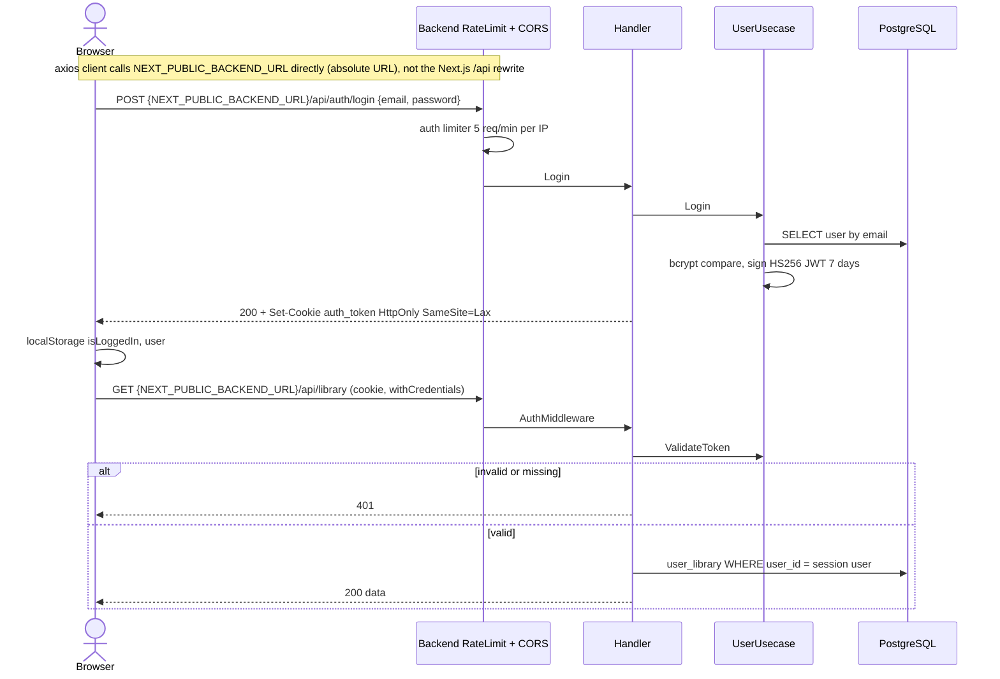
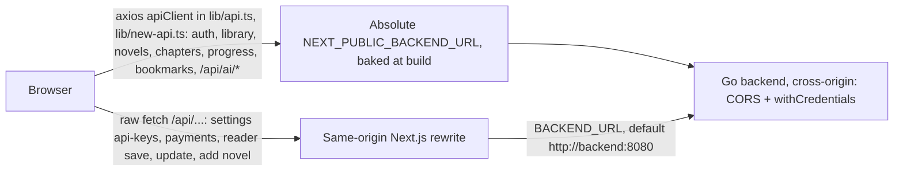
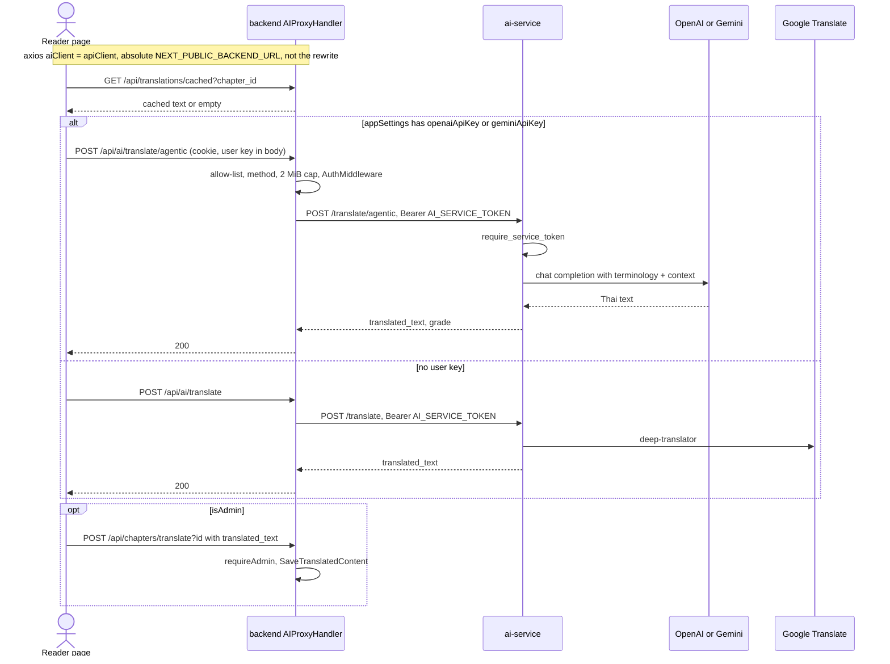
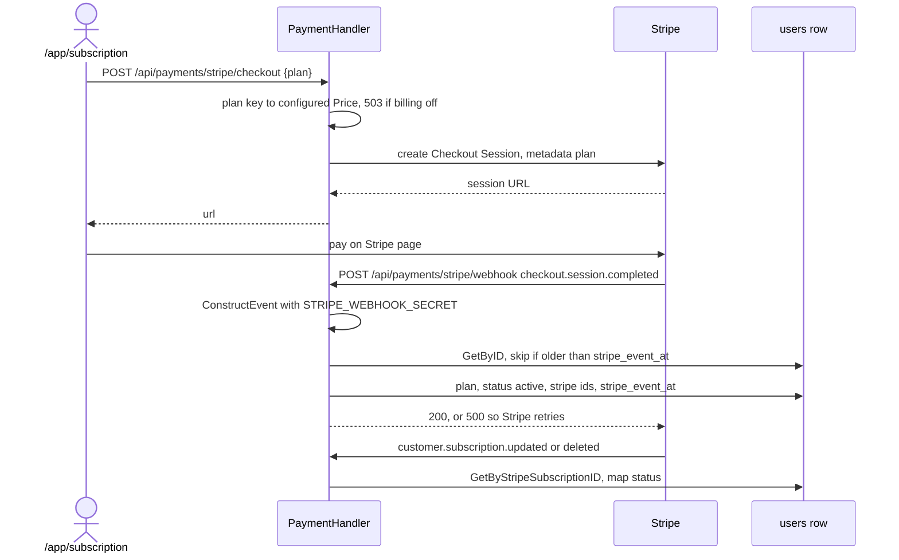
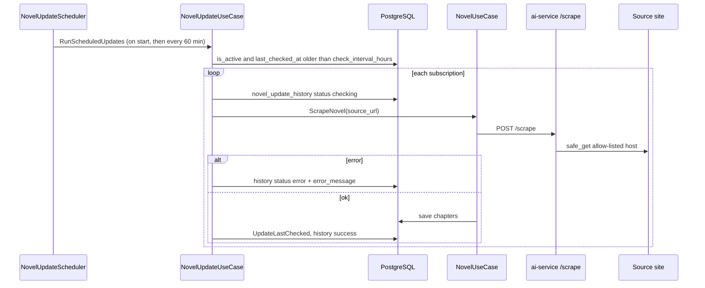

# 10 — Sequences

สี่ request path ที่สำคัญที่สุด sequence เรื่อง reading-progress sync มีใน central pack
[03-system-sequence.md](https://github.com/bookchaowalit/architecture-docs/blob/main/docs/architecture/flows/bookreading-ui/03-system-sequence.md) (reused ส่วน progress;
ส่วน review ใน pack นั้นล้าสมัย — frontend ไม่เรียก ai-service ตรงแล้ว)

## 1. Login และ request ที่ต้อง session

Sources: `backend/internal/delivery/http/server.go`, `backend/internal/delivery/http/handler.go` (`Login`, `setAuthCookie`, `AuthMiddleware`),
`backend/internal/usecase/user_usecase.go`, `backend/internal/middleware/rate_limit.go`, `frontend/src/app/login/page.tsx`, `frontend/src/lib/api.ts`, `frontend/src/lib/new-api.ts` (`NEXT_PUBLIC_BACKEND_URL`, default `http://localhost:8080`; Compose sets `http://localhost:8888`), `frontend/next.config.ts` (the `/api/*` rewrite to `BACKEND_URL` serves only same-origin relative calls)

### สองเส้นทางจาก browser ไป backend

Sources: `frontend/src/lib/api.ts`, `frontend/src/lib/new-api.ts`, `frontend/next.config.ts` (`rewrites`), `frontend/src/app/app/settings/page.tsx`,
`frontend/src/app/app/subscription/page.tsx`, `frontend/src/app/app/reader/page.tsx`, `docker-compose.yml` (`NEXT_PUBLIC_BACKEND_URL: http://localhost:8888`, `BACKEND_URL: http://backend:8080`)

ใน production (ตรวจ 2026-11-03) JS bundle ของ `/login` ฝัง `http://localhost:8080` (ค่า default ใน `lib/api.ts`) — axios calls ทั้งหมดรวม login จึงยิงไป localhost ของผู้เข้าชม
ส่วน raw `fetch('/api/...')` ไป rewrite แล้วได้ 502 `DNS_HOSTNAME_NOT_FOUND` — แก้ rewrite อย่างเดียวไม่พอ ต้องตั้ง `NEXT_PUBLIC_BACKEND_URL` แล้ว build ใหม่ด้วย

## 2. Reader แปลบทผ่าน `/api/ai`

Sources: `frontend/src/app/app/reader/page.tsx`, `frontend/src/lib/api.ts`, `backend/internal/delivery/http/ai_proxy_handler.go`,
`backend/internal/infrastructure/aiservice/client.go`, `ai-service/service_auth.py`, `ai-service/main.py` (`/translate`, `/translate/agentic`),
`ai-service/agentic_translator.py`, `backend/internal/delivery/http/handler.go` (`TranslateChapter`)

หมายเหตุ: เลือก agentic หรือ Google จาก `localStorage.appSettings` (key ของผู้ใช้เอง) ไม่ใช่จากความล้มเหลว — key ถูกส่งใน body ผ่าน proxy (ดู [13-threat-model.md](./13-threat-model.md))

## 3. Stripe checkout และ webhook

Sources: `backend/internal/delivery/http/payment_handler.go`, `backend/internal/delivery/http/billing_plans.go`, `frontend/src/app/app/subscription/page.tsx`,
`database/migrations/007_index_users_stripe_subscription.up.sql`, `database/migrations/008_add_users_stripe_event_at.up.sql`

## 4. Scheduler re-scrape นิยายที่ subscribe

Sources: `backend/cmd/main.go`, `backend/internal/scheduler/novel_update.go`, `backend/internal/usecase/novel_update_usecase.go`,
`backend/internal/usecase/novel_usecase.go`, `backend/internal/infrastructure/aiservice/client.go`, `ai-service/main.py` (`/scrape`), `ai-service/url_safety.py`

`GetDueForUpdate` เลือกเฉพาะ `is_active = true` และ `last_checked_at IS NULL OR last_checked_at < NOW() - check_interval_hours` (default 12 ชม.)
ดังนั้น tick ทุก 60 นาทีจะ scrape เรื่องเดิมซ้ำไม่บ่อยกว่า interval (`backend/internal/repository/postgres/novel_subscription_repo.go`)

## Open questions

- ไม่มี — ทุก path ข้างบนอ่านจากโค้ด; ไม่ได้รันจริงในรอบนี้ (production ไม่มี backend)
