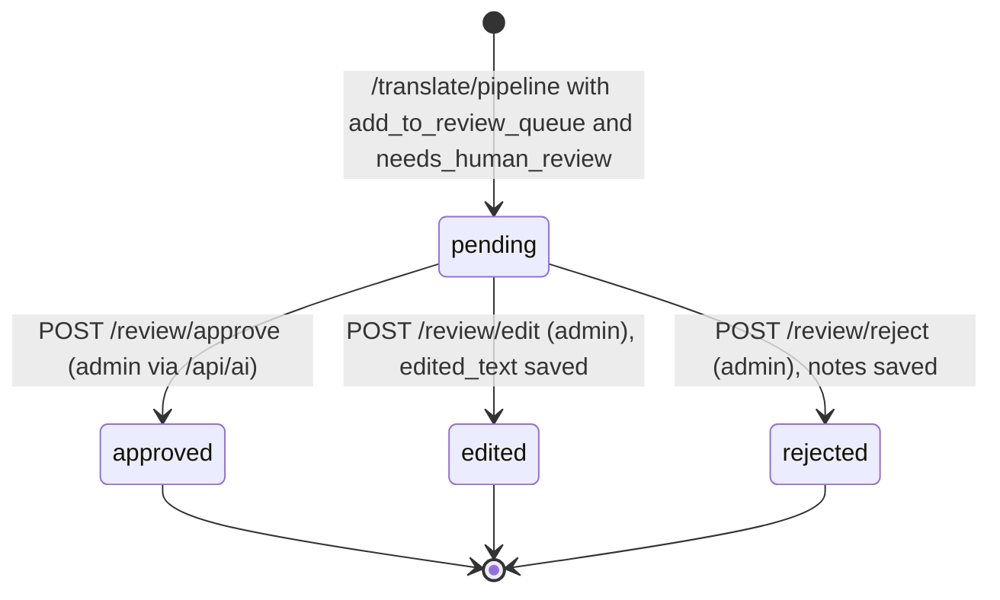
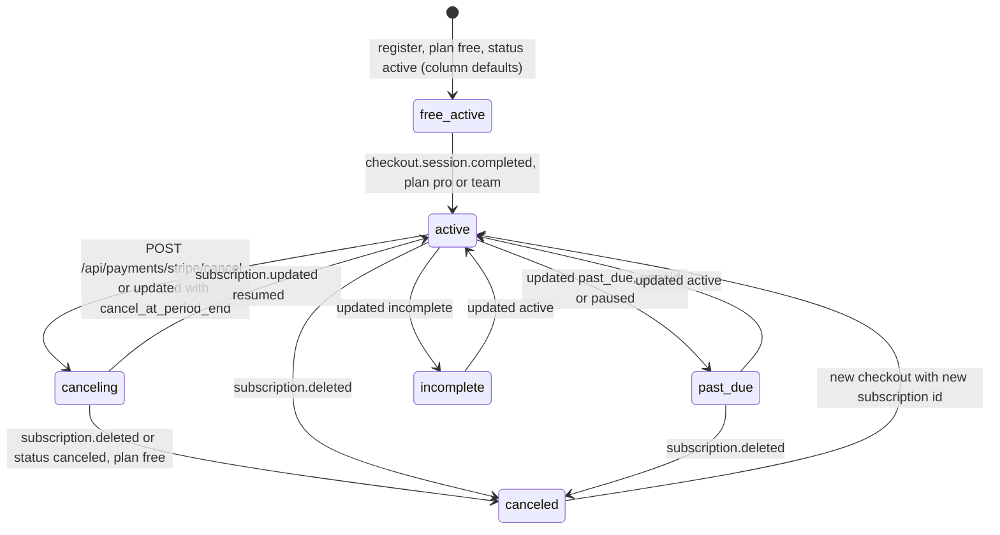
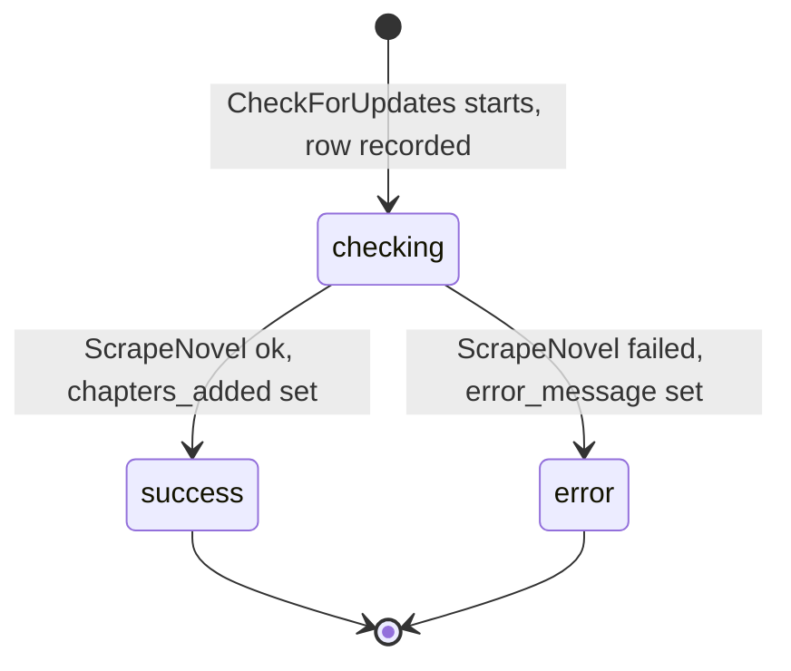

# 11 — State machines

Entity ที่มี field สถานะและมีโค้ดเปลี่ยนสถานะจริง central pack
[04-state-machine.md](https://github.com/bookchaowalit/architecture-docs/blob/main/docs/architecture/flows/bookreading-ui/04-state-machine.md) ถูก reuse เป็นจุดตั้งต้น
แต่สองข้อแก้ตามโค้ดปัจจุบัน: `/review/edit` ตั้งสถานะ `edited` (ไม่ใช่ `approved`) และ `canceling → canceled/free` มีโค้ดแล้ว (pass 2)

## 1. Review queue item (`review_queue.status`, ai-service)

Sources: `ai-service/multi_agent_translator.py` (`ReviewStatus`), `ai-service/db_manager.py` (`approve_review`, `edit_review`, `reject_review`),
`ai-service/main.py` (`/review/*`), `backend/internal/delivery/http/ai_proxy_handler.go` (admin flags), `database/init.sql` (`review_queue`)

`/review/stats` นับ `approved` รวม `edited` (`db_manager.get_review_stats`) แต่ route `/review/stats` ใน `main.py` อ่านจาก in-memory queue เท่านั้น
และ SQL ของ approve/edit/reject ไม่กรอง `status = 'pending'` จึงเปลี่ยนจากสถานะ final ได้อีก (ไม่ได้วาดเป็น transition เพราะไม่ใช่การออกแบบที่ตั้งใจ — ดู open question)

## 2. Subscription (`users.subscription_status` + `subscription_plan`)

Sources: `backend/internal/delivery/http/payment_handler.go` (`applyCheckoutCompleted`, `syncSubscription`, `subscriptionStatusFor`, `CancelSubscription`),
`database/migrations/010_align_users_with_app.up.sql` (defaults), `frontend/src/lib/subscriptionStatus.ts`, `docs/UPGRADE-PLAN.md` (pass 2–3)

Guard: event ที่ `created` เก่ากว่า `users.stripe_event_at` ถูกข้าม และ checkout ของ subscription ที่ user ถืออยู่เป็น `canceled` ถูกข้าม (`isStaleEvent`, pass 3)

## 3. Novel update check (`novel_update_history.status`)

Sources: `backend/internal/usecase/novel_update_usecase.go`, `database/migrations/004_add_novel_tracking.up.sql`

ไม่มี retry อัตโนมัติ; รอบถัดไปของ scheduler จะเลือก subscription เดิมอีกเมื่อพ้น `check_interval_hours` เพราะ `UpdateLastChecked` ไม่ถูกเรียกเมื่อ error

## Field ที่ไม่ได้วาด

| Field | เหตุผล |
|---|---|
| `novels.status` (default `ongoing`) | ไม่พบโค้ดที่เปลี่ยนค่า |
| `novel_subscriptions.is_active` | สร้างเป็น `true`; unsubscribe ลบแถว ไม่ได้ตั้ง `false` |
| `users.role` | `user` → `admin` ผ่าน `ADMIN_USER_IDS`/SQL เท่านั้น (ไม่มี demote ในโค้ด) |
| grade A–D | เป็น classification ไม่ใช่ state |

## Open questions

- approve/edit/reject ควรถูกจำกัดให้ทำได้เฉพาะ item ที่ `pending` หรือไม่
- ผู้ใช้ใหม่มี `subscription_status = active` คู่กับ plan `free` — ตั้งใจหรือไม่ (frontend แสดงผลอย่างไรกับคู่นี้)
