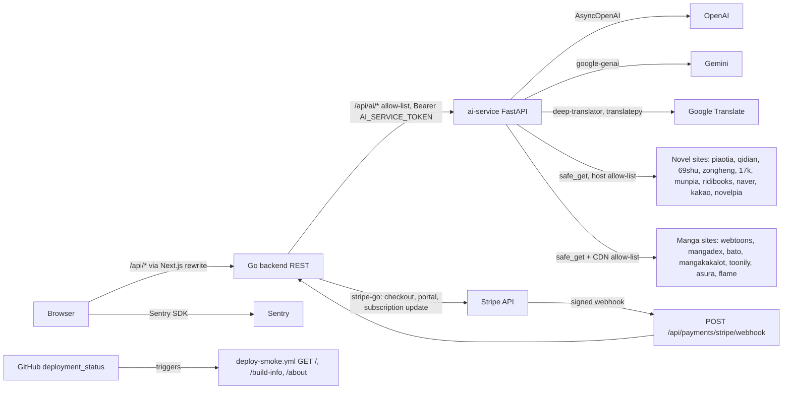

# 12 — API and integrations

**Reused:** รายละเอียด request/response อยู่ใน [`docs/API.md`](../API.md) และ [`docs/openapi.yaml`](../openapi.yaml) — ไฟล์นี้ไม่คัดลอกซ้ำ
แต่ทำ inventory เทียบกับ route ที่ลงทะเบียนจริงใน `server.go` และวาด integration flow

## Integration map

Sources: `frontend/next.config.ts`, `backend/internal/delivery/http/server.go`, `backend/internal/delivery/http/ai_proxy_handler.go`,
`backend/internal/delivery/http/payment_handler.go`, `ai-service/agentic_translator.py`, `ai-service/main.py`, `ai-service/url_safety.py`,
`ai-service/site_routing.py`, `frontend/src/lib/sentry.ts`, `.github/workflows/deploy-smoke.yml`

## Backend endpoint inventory (`server.go`) เทียบกับเอกสาร

| Route | Methods | Access | ใน API.md | ใน openapi.yaml |
|---|---|---|---|---|
| `/api/auth/register`, `/login` | POST | public, 5/min | yes | yes |
| `/api/auth/logout` | POST | public | no | no |
| `/api/auth/refresh` | any | auth | no | no |
| `/api/users/me`, `/me/update`, `/me/delete` | any | auth | mentioned | no |
| `/api/library` | GET POST DELETE | auth | yes | no |
| `/api/terminology` | GET POST DELETE | auth | yes | no |
| `/api/novels` | GET public, POST admin | mixed | yes | yes (no admin note) |
| `/api/novels/detail` | GET | public | yes | no |
| `/api/chapters`, `/detail`, `/by-number` | GET | public | yes | no |
| `/api/chapters/update` | POST PUT | admin | yes | no |
| `/api/chapters/translate` | POST | auth, 10/min; `translated_text` admin | yes | yes (body schema differs) |
| `/api/translations/history`, `/cached` | GET | public, 10/min | no | no |
| `/api/subscriptions` | GET POST DELETE | auth | README | no |
| `/api/subscriptions/trigger-update` | any | admin | yes | no |
| `/api/subscriptions/history` | any | auth | no | no |
| `/api/reading-progress`, `/novel` | GET POST | auth | README | no |
| `/api/bookmarks`, `/novel` | GET POST DELETE | auth | README | no |
| `/api/feedback`, `/chapter`, `/quality-score` | GET POST | auth, 10/min | README | no |
| `/api/settings/api-keys` | GET POST DELETE | auth | README | no |
| `/api/payments/plans`, `/subscription` | any | auth | mentioned | no |
| `/api/payments/stripe/checkout`, `/billing-portal`, `/cancel` | any | auth | mentioned | no |
| `/api/payments/stripe/webhook` | POST | Stripe signature | no | no |
| `/api/ai/*` (21 paths + `/terminology/{id}`) | per route | auth; 3 public; 3 admin | yes | no |
| `/api/health`, `/api/ready`, `/api/health/detailed` | GET | public | health only | health only |

Sources: `backend/internal/delivery/http/server.go`, `backend/internal/delivery/http/ai_proxy_handler.go`, `docs/API.md`, `docs/openapi.yaml`, `README.md`

## ai-service endpoints ที่ไม่ถูก proxy

`/translate/pipeline`, `/terminology/update`, `/pipeline/stats`, `/sources/korean`, `/review/{item_id}`, `/approved/{novel_id}/{chapter_number}` มีใน `main.py`
แต่ไม่อยู่ใน `aiProxyRoutes` — browser เรียกไม่ได้ และ Go client ไม่เรียก (`aiservice/client.go` ใช้แค่ `/scrape`, `/translate`, `/extract-terminology` + `Forward`)

## ความไม่ตรงกันที่พบ

- `docs/openapi.yaml`: `/api/chapters/translate` ระบุ body `novel_id`, `chapter_number`, `translator_type` แต่ handler อ่าน query `id` + body `target_lang`, `use_context`, `translated_text`, `model_used` (`handler.go`)
- `docs/API.md` / openapi `servers`: `https://api.bookreading.app` — ไม่พบ host นี้ใน config ใด ๆ; production frontend คือ `bookreading.bookchaowalit.com`
- `docs/API.md` gRPC `localhost:9090` — server ไม่ถูก start (`cmd/main.go`)
- frontend เรียก `GET /api/feedback/history` (`new-api.ts`) แต่ไม่มี route นี้
- `GET /api/payments/plans` คืน `billing_enabled` แต่หน้า subscription hard-code ราคา (`docs/UPGRADE-PLAN.md` P1)

## Open questions

- `api.bookreading.app` ยังเป็นแผนอยู่หรือควรลบจากเอกสาร
- ควร generate openapi.yaml จาก route table (`routes_access_test.go` มี list ครบแล้ว) หรือไม่
