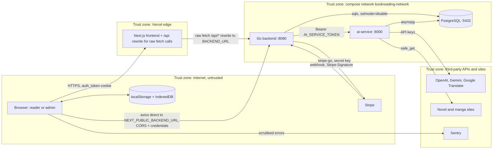

# 13 — Threat model (DFD + STRIDE)

DFD ของ stack ตาม `docker-compose.yml` + Vercel frontend ส่วน authz ของ central pack
[06-authz-decision.md](https://github.com/bookchaowalit/architecture-docs/blob/main/docs/architecture/flows/bookreading-ui/06-authz-decision.md) ถูกแทนด้วยตารางนี้
(gap "review queue ไม่มี auth" ใน pack ถูกปิดแล้วใน pass 7–8)

Sources: `docker-compose.yml`, `frontend/next.config.ts`, `backend/internal/delivery/http/server.go`, `backend/internal/delivery/http/handler.go`,
`backend/internal/delivery/http/ai_proxy_handler.go`, `backend/internal/delivery/http/payment_handler.go`, `ai-service/service_auth.py`, `ai-service/url_safety.py`,
`frontend/src/lib/sentry.ts`, `frontend/src/lib/offline-storage.ts`

## STRIDE ต่อ element

| Element | S | T | R | I | D | E | Mitigation ที่มีในโค้ด | Gap |
|---|---|---|---|---|---|---|---|---|
| Browser / localStorage | x | | | x | | | session อยู่ใน cookie `HttpOnly`; `authHeader()` ไม่ส่ง `Bearer null` | **G1** OpenAI/Gemini key ของผู้ใช้ถูกเก็บใน `localStorage.appSettings` (หน้า settings บันทึกไป backend เฉพาะเมื่อมี `localStorage.token` ซึ่ง login ลบทิ้ง) และส่งใน body ของ `/api/ai/translate/agentic` — XSS อ่านได้ ขัดกับ README "Server-Side API Keys"; ไม่พบ CSP ใน `next.config.ts` |
| Next.js frontend (Vercel) | | x | | | x | | Sentry scrub request/user/breadcrumbs/query (AC-02) | `/app/*` guard เป็น `localStorage.isLoggedIn` (UI เท่านั้น); `/api/*` 502 ใน prod |
| Backend auth | x | | | | | x | bcrypt, JWT HS256 + `JWT_SECRET` บังคับ, `SameSite=Lax`, `Secure` ใน prod, auth limiter 5/min, `routes_access_test.go` ล็อกทุก route, admin อ่าน role จาก DB | ไม่มี email verification, ไม่มี token revoke (อายุ 7 วัน); `ValidateToken` ไม่ตรวจ `alg` ชัดเจน (พึ่ง key type ของ jwt v5) |
| Backend per-user data | | x | | x | | x | `sessionUserID` → 403 เมื่อ `user_id` ไม่ตรง; ลบของคนอื่น → 404 (`ownership_test.go`) | — |
| Backend catalog writes | | x | | | | x | `POST /api/novels`, `/chapters/update`, save `translated_text` = admin | — |
| `/api/ai` proxy | | x | | x | x | x | allow-list, ห้าม `%`/`//`/dot segments, 2 / 32 MiB cap, ไม่ส่ง cookie ผู้ใช้ต่อ, review moderation = admin | **G2** `/review/pending`, `/stats` อ่านได้ทุก user; **G3** translate/manga POST มีแค่ global limit (ไม่มี quota ต่อ user/plan) |
| ai-service | x | | x | | x | | `require_service_token` (constant-time), loopback bind, SSRF guard: host allow-list, ปฏิเสธ private/metadata IP, pin IP + SNI, redirect re-validate, 5 MB cap | **G4** token ว่าง = เปิดทุก route; **G5** `reviewer` มาจาก request body → `reviewed_by` ปลอมได้; Webtoons Playwright path resolve DNS เอง (UPGRADE-PLAN P1) |
| Stripe webhook | x | x | | | | | `ConstructEvent` + `STRIPE_WEBHOOK_SECRET` (ไม่ตั้ง = ปฏิเสธ), body cap, stale-event guard | — |
| PostgreSQL | | x | | x | x | | publish `127.0.0.1` เท่านั้น, API key เข้ารหัส AES-256-GCM **เฉพาะเมื่อตั้ง `API_KEY_ENCRYPTION_KEY`** (`crypto/apikeys.go`) — ถ้าไม่ตั้งหรือ format ผิดจะเก็บ plaintext และ env template/compose ที่ commit ไว้ไม่ได้ตั้งค่านี้, password ต้องตั้ง (`POSTGRES_PASSWORD:?`) | `sslmode=disable` (ภายใน compose network); backup ไม่เข้ารหัส (ดู 14) |
| Rate limiter | | | | | x | | fixed window, XFF เชื่อเฉพาะ `TRUSTED_PROXIES` | in-memory ต่อ instance |
| CORS | | | | x | | | `ALLOWED_ORIGINS` exact match, security headers ทุก response | ถ้าตั้ง `*` จะส่ง `ACAO: *` คู่ `Allow-Credentials: true` (browser ปฏิเสธเอง) |
| gRPC | x | | | | | | interceptor ต้อง `GRPC_SERVICE_TOKEN`, bind loopback | server ไม่ได้ start |
| Supply chain | | x | | | | | GitHub Actions pin SHA, `security.yml` (gitleaks, Semgrep, OSV, Trivy), `requirements.txt --require-hashes`, container uid 1001 | `actions/checkout@v4` ใน ci.yml/docker-build.yml ยังไม่ pin SHA |

Sources: `backend/internal/delivery/http/handler.go`, `backend/internal/usecase/user_usecase.go`, `backend/internal/delivery/http/routes_access_test.go`,
`backend/internal/delivery/http/ownership_test.go`, `backend/internal/middleware/rate_limit.go`, `backend/internal/crypto/apikeys.go`, `backend/internal/delivery/grpc/auth.go`,
`ai-service/main.py` (`/review/*`), `frontend/src/app/app/settings/page.tsx`, `frontend/src/app/app/reader/page.tsx`, `frontend/src/lib/api.ts`,
`frontend/src/app/app/layout.tsx`, `.github/workflows/ci.yml`, `.github/workflows/docker-build.yml`, `ai-service/Dockerfile`, `docs/UPGRADE-PLAN.md`

## Open questions

- G1: ตั้งใจให้ผู้อ่านใช้ key ของตัวเอง (BYOK) จาก browser หรือควรใช้ `user_api_keys` ฝั่ง server เสมอ?
- G2: review queue ควรเป็น admin-only ทั้งหมด (UPGRADE-PLAN P1 ยังเปิด)
- ใครคือ data owner / มี privacy notice เรื่องการส่งเนื้อหาไป OpenAI/Gemini หรือไม่ (`/privacy` page มี แต่ไม่ได้อ่านเนื้อหา)
