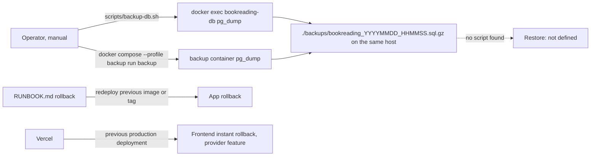

# 14 — Backup and DR

## ข้อมูลที่มีและอยู่ที่ไหน

| Data | Where | Criticality | Recoverable from |
|---|---|---|---|
| users (email, bcrypt hash, role, plan, Stripe ids) | PostgreSQL volume `postgres_data` | สูง | backup เท่านั้น; plan/status sync ใหม่ได้จาก Stripe webhook (Stripe เก็บ subscription จริง) |
| novels, chapters, terminology, translation_history, translation_cache | PostgreSQL | กลาง | scrape + แปลใหม่ได้ (เสียเงิน LLM) |
| reading_progress, bookmarks, user_library, user_terminology, translation_feedback | PostgreSQL | กลาง (ของผู้ใช้) | backup เท่านั้น |
| user_api_keys (encrypted) | PostgreSQL | สูง (secret) | ผู้ใช้กรอกใหม่ |
| review_queue (+ pipeline tables จาก init.sql) | PostgreSQL + in-memory `review_queue` | ต่ำ (ว่างใน As-Is) | — |
| translation cache ของ ai-service | in-memory (`translation_cache.py`) | ต่ำ | หายเมื่อ restart โดยออกแบบ |
| offline chapters, library cache, settings, (G1) user LLM keys | browser IndexedDB / localStorage | ของผู้ใช้ | ไม่มี — อยู่ในเครื่องผู้ใช้ |
| Secrets (`JWT_SECRET`, `POSTGRES_PASSWORD`, Stripe, LLM, `AI_SERVICE_TOKEN`) | `.env` (ไม่ commit) | สูง | ไม่ระบุใน repo |

Sources: `docker-compose.yml`, `database/migrations/*.up.sql`, `database/init.sql`, `ai-service/translation_cache.py`, `ai-service/multi_agent_translator.py`,
`frontend/src/lib/offline-storage.ts`, `.gitignore`, `RUNBOOK.md`

## Backup / restore ที่มีจริง

Sources: `scripts/backup-db.sh`, `docker-compose.yml` (service `backup`, profile `backup`), `RUNBOOK.md` (Rollback), `.github/workflows/docker-build.yml` (image tags `sha`, semver)

## ข้อเท็จจริง

- backup เป็น manual ทั้งสองทาง ไม่มี cron/workflow; ไฟล์อยู่ host เดียวกับ DB (ไม่มี offsite, ไม่เข้ารหัส)
- `./backups/` **ไม่อยู่ใน `.gitignore`** — dump ที่มี email + password hash อาจถูก commit โดยไม่ตั้งใจ
- ไม่พบ restore script / restore drill / `pg_restore` ใน repo
- migration มี down ทุกตัวและ CI ทดสอบ up/down/up (`scripts/check-migrations.sh`) — ช่วย rollback schema ไม่ใช่ข้อมูล
- Docker image ถูก tag ด้วย `sha` แต่ push เฉพาะเมื่อมี Docker Hub secrets
- production วันนี้ไม่มี DB (frontend-only บน Vercel) — จึงไม่มีข้อมูล production ที่ต้อง backup ณ 2026-11-03

## RTO / RPO

- RTO: **not defined**
- RPO: **not defined** (ด้วย manual dump จริง ๆ RPO = ตั้งแต่ dump ล่าสุดที่ operator สั่ง)

## Open questions

- เมื่อ backend + DB ขึ้น production จะใช้ provider ไหน (Neon / Railway Postgres มี PITR ของตัวเอง) และจะเข้า nightly encrypted backup ที่ owner ใช้กับ repo อื่นหรือไม่
- ควรเพิ่ม `backups/` ใน `.gitignore` (เป็นการแก้ config — นอกขอบเขต docs-only ของงานนี้)
- RTO/RPO เป้าหมายของ owner
