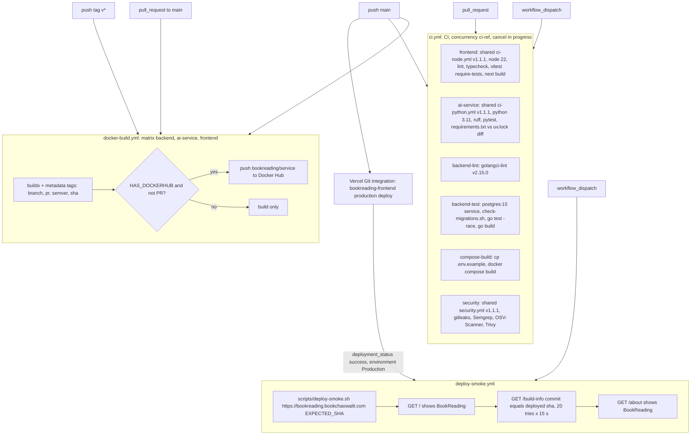

# 15 — CI/CD pipeline

สาม workflow ใน `.github/workflows/` (public repo → GitHub-hosted runners) CI ไม่ deploy; deploy ทำโดย Vercel Git integration

Sources: `.github/workflows/ci.yml`, `.github/workflows/docker-build.yml`, `.github/workflows/deploy-smoke.yml`, `scripts/deploy-smoke.sh`, `scripts/check-migrations.sh`,
`frontend/src/app/build-info/route.ts`, `specs/001-next16-shared-ci-sentry/spec.md` (workflow migration table)

## หมายเหตุ

- ไม่มี `needs:` ระหว่าง job — ทุก job ใน `ci.yml` รันขนานกัน และ Vercel deploy ไม่รอ CI (ไม่มี branch protection / required checks บน `main`, `gh api .../branches/main/protection` → 404)
- Playwright e2e (`frontend/e2e/landing.spec.ts`, `npm run test:e2e`) ไม่ถูกเรียกใน workflow ใด
- backend และ ai-service ไม่มี deploy job; image บน Docker Hub (ถ้า push) ไม่มีผู้ใช้ที่ระบุใน repo
- workflow เก่า `frontend-ci.yml`, `backend-ci.yml`, `ai-service-ci.yml` ถูกลบใน `77d6f45` (2026-10-22) และ `ci.yml` ถูกเขียนใหม่ใน `b7eb40b` (run ของ workflow เก่ายังเห็นใน `gh run list` ถึง 2026-10-15)

## Open questions

- ต้องการให้ Vercel deploy รอ CI เขียว (required checks หรือ Vercel "Ignored Build Step") หรือไม่
- Docker Hub secrets ตั้งไว้หรือไม่ (`HAS_DOCKERHUB`) — log ของ run ไม่ได้ตรวจในรอบนี้
