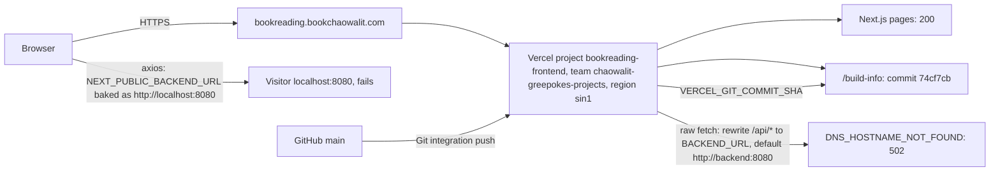
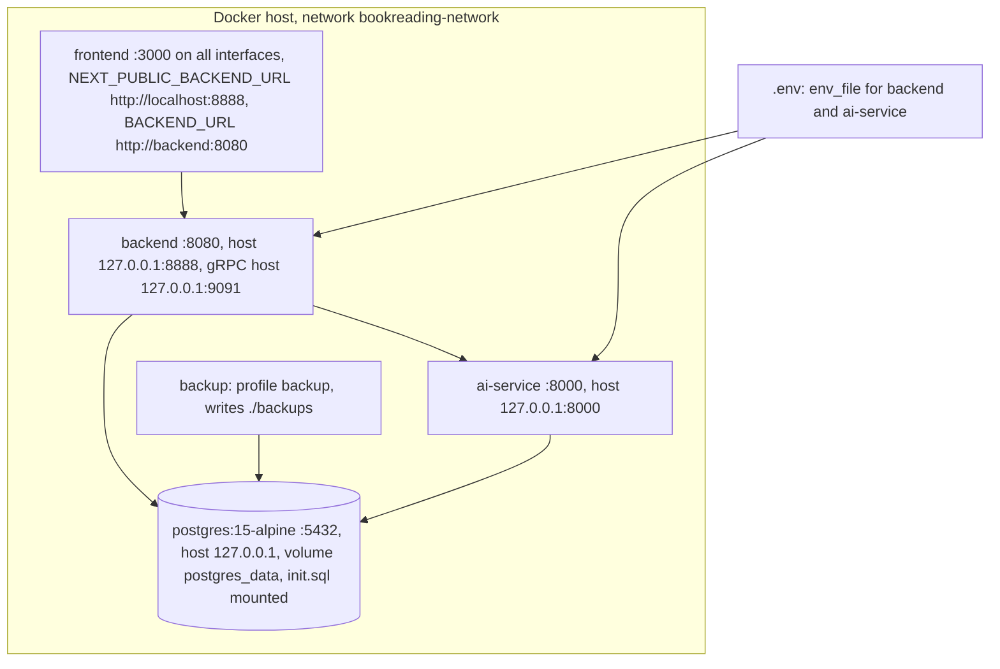

# 16 — Deployment

สองโลก: (A) production ที่มีอยู่จริงวันนี้ = frontend บน Vercel อย่างเดียว และ (B) stack เต็มตาม `docker-compose.yml` (local / self-host)

## A. Production (ตรวจ 2026-11-03)

Sources: `frontend/next.config.ts` (`rewrites`), `frontend/src/app/build-info/route.ts`, `.github/workflows/deploy-smoke.yml`, `scripts/deploy-smoke.sh`,
`specs/001-next16-shared-ci-sentry/spec.md` (Deploy), ผลตรวจ: `curl https://bookreading.bookchaowalit.com/{build-info,api/health,api/novels}` และ `vercel ls bookreading-frontend --prod` (2026-11-03)

Production deployments ที่ Vercel แสดง: 2026-08-12 (CLI, ก่อนต่อ Git), 2026-10-23, 2026-10-24 ×3 — ดู [22-dora.md](./22-dora.md)

## B. Full stack (`docker-compose.yml`)

Sources: `docker-compose.yml`, `backend/Dockerfile`, `ai-service/Dockerfile`, `frontend/Dockerfile`, `Makefile` (migrate), `README.md` (Quick Start)

## Environment variables (ชื่อเท่านั้น)

| Service | Variables (จากโค้ด / compose) |
|---|---|
| backend | `DATABASE_URL`, `HTTP_PORT`, `JWT_SECRET`, `ALLOWED_ORIGINS`, `AI_SERVICE_URL`, `AI_SERVICE_TOKEN`, `ADMIN_USER_IDS`, `STRIPE_SECRET_KEY`, `STRIPE_WEBHOOK_SECRET`, `STRIPE_PRICE_PRO`, `STRIPE_PRICE_TEAM`, `FRONTEND_URL`, `STRIPE_BILLING_PORTAL_RETURN_URL`, `NODE_ENV`, `COOKIE_SECURE`, `TRUSTED_PROXIES`, `HTTP_*_TIMEOUT`, `HTTP_MAX_HEADER_BYTES`, `GRPC_SERVICE_TOKEN`, `API_KEY_ENCRYPTION_KEY`, `LOG_LEVEL`, `APP_ENV` |
| ai-service | `DATABASE_URL`, `LLM_PROVIDER`, `OPENAI_API_KEY`, `GEMINI_API_KEY`, `ALLOWED_ORIGINS`, `AI_SERVICE_TOKEN`, `SCRAPE_EXTRA_ALLOWED_HOSTS`, `MANGA_EXTRA_ALLOWED_HOSTS`, `MANGA_IMAGE_EXTRA_ALLOWED_HOSTS`, `LLM_MODEL`, `OPENAI_MODEL`, `GEMINI_MODEL` |
| frontend | `NEXT_PUBLIC_BACKEND_URL`, `BACKEND_URL`, `NEXT_PUBLIC_SENTRY_DSN`, `NEXT_PUBLIC_AI_DIRECT_URL` (local only), `VERCEL_GIT_COMMIT_SHA` (Vercel) |

Sources: `docker-compose.yml`, `backend/internal/delivery/http/server.go`, `backend/internal/delivery/http/server_config.go`, `backend/internal/delivery/http/handler.go`,
`backend/internal/delivery/http/payment_handler.go`, `backend/internal/middleware/rate_limit.go`, `backend/internal/delivery/grpc/auth.go`, `backend/internal/crypto/apikeys.go`, `ai-service/service_auth.py`, `ai-service/agentic_translator.py`,
`ai-service/url_safety.py`, `frontend/src/lib/api.ts`, `frontend/src/instrumentation.ts`, `frontend/src/app/build-info/route.ts`

## ช่องว่าง

- ไม่มี host ของ backend / ai-service / Postgres ใน production → ทุก feature ที่ต้อง login ใช้ไม่ได้บน prod
- compose healthcheck backend ใช้ `/health` แต่ route คือ `/api/health`
- `NEXT_PUBLIC_BACKEND_URL` ฝังตอน build; JS bundle ของ production (`/login`, 2026-11-03) มี `http://localhost:8080` = ค่า default ของ `lib/api.ts` จึงไม่ได้ตั้งบน Vercel — ต้องตั้งทั้งตัวนี้และ `BACKEND_URL`

## Open questions

- จะ host backend + ai-service + DB ที่ไหน (ตาม policy owner: Railway Singapore + Neon ต่อ project?) และ `BACKEND_URL` บน Vercel จะชี้ไปไหน
- ควรปิด rewrite `/api/*` หรือแสดงหน้า "ยังไม่เปิดบริการ" จนกว่า backend จะขึ้น
