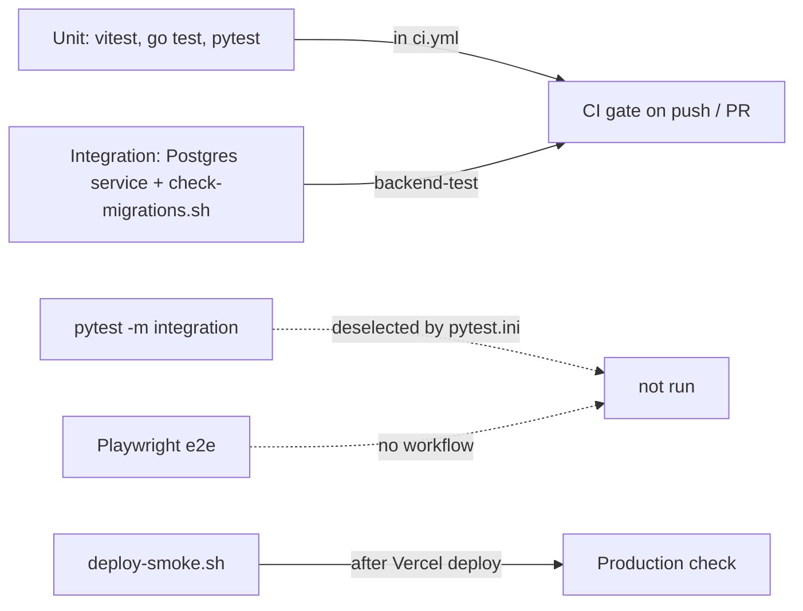

# 17 — Test coverage matrix

ระดับ test นิยามจากไฟล์จริง:
**unit** = ไม่มี DB/network (vitest, `go test` กับ in-memory repo / httptest, pytest ที่ mock DNS/HTTP);
**integration** = ใช้ Postgres จริงหรือ service จริง (`user_repository_db_test.go` + `scripts/check-migrations.sh` ใน CI, `test_pipeline.py` marker `integration` ที่ถูก deselect);
**e2e** = Playwright (`frontend/e2e/`) — ไม่อยู่ใน CI

| Feature | Unit | Integration | E2E | Gap |
|---|---|---|---|---|
| Landing / public pages | — | — | `frontend/e2e/landing.spec.ts` (ไม่รันใน CI) | e2e ไม่อยู่ใน CI |
| Register / login / JWT | `backend/internal/usecase/usecase_test.go`, `handler_test.go` (`TestAuthMiddleware`), `routes_access_test.go` (`TestBearerToken`, cookie fallback) | `user_repository_db_test.go` (round trip) | — | ไม่มี test ของ login page |
| Route access levels (public/auth/admin) | `routes_access_test.go`, `ai_proxy_handler_test.go` | — | — | — |
| Per-user ownership (IDOR) | `ownership_test.go` | `user_repository_db_test.go` (`TestUserTerminologyDeleteIsOwnerScoped`) | — | — |
| Admin bootstrap | `server_config_test.go` (`TestParseAdminUserIDs`, `TestBootstrapAdminsNeverPromotesByEmail`) | `user_repository_db_test.go` (`...PromoteByID`) | — | — |
| `/api/ai` proxy | `ai_proxy_handler_test.go`, `infrastructure/aiservice/client_test.go` | — | — | — |
| Frontend API client / interceptor | `frontend/src/lib/__tests__/api.test.ts` | — | — | — |
| Reading progress | `frontend/src/hooks/__tests__/useReadingProgress.test.ts`, `ownership_test.go` (`TestReadingProgressIsScopedToSessionUser`) | — | — | ไม่มี test ของ `reading_progress_repo.go` กับ DB |
| Reading stats / streak | `frontend/src/lib/__tests__/readingStats.test.ts` | — | — | — |
| Bookmarks, feedback | `ownership_test.go` | — | — | ไม่มี test usecase `translation_feedback_usecase.go` |
| Library, terminology (backend) | `ownership_test.go` (terminology delete), `routes_access_test.go` (library access level only) | `user_repository_db_test.go` (terminology) | — | library handler/repo ไม่มี behaviour test |
| Novel catalog / chapters | `routes_access_test.go` (`TestChapterWritesNeedAdmin`), `usecase/pagination_test.go` | — | — | ไม่มี test ของ `novel_usecase.go`, `chapter_usecase.go` (translate) |
| Novel auto-update scheduler | `ownership_test.go` (`TestTriggerUpdateIsAdminOnly`, subscriptions) | — | — | `novel_update_usecase.go`, `scheduler/novel_update.go` ไม่มี test |
| Billing / Stripe webhook | `payment_handler_test.go`, `payment_ordering_test.go`, `payment_subscription_test.go`, `billing_plans_test.go` | — | — | ไม่มี test กับ Stripe test mode |
| Subscription status labels | `frontend/src/lib/__tests__/subscriptionStatus.test.ts` | — | — | หน้า `/app/subscription` ไม่มี test |
| API key encryption | `backend/internal/crypto/apikeys_test.go` | — | — | `api_key_handler.go` ไม่มี test |
| Rate limiting | `backend/internal/middleware/rate_limit_test.go` | — | — | — |
| HTTP server config | `server_config_test.go` | — | — | — |
| gRPC auth / pagination | `delivery/grpc/auth_test.go`, `delivery/grpc/pagination_test.go` | — | — | server ไม่ได้ start |
| DB migrations | — | `scripts/check-migrations.sh` (CI `backend-test`) | — | — |
| ai-service service token | `ai-service/test_service_auth.py` | — | — | — |
| SSRF / URL safety | `test_url_safety.py`, `test_manga_ssrf.py` | — | — | Webtoons Playwright path |
| Scraper routing / parsers | `test_source_routing.py`, `test_scrapers.py` | — | — | — |
| Terminology | `test_terminology.py` | — | — | — |
| Translation pipeline | `test_improved_pipeline.py` | `test_pipeline.py` (marker `integration`, ไม่รันใน CI) | — | `agentic_translator.py` / LLM path ไม่มี unit test |
| Manga translate-url | `test_manga_translate_url.py` | — | — | `manga_translator.py` OCR ไม่มี test |
| Review queue (ai-service) | — | — | — | `/review/*` handler + `db_manager.py` ไม่มี test |
| Review page (frontend) | `frontend/src/app/admin/review/__tests__/ReviewPage.test.tsx` | — | — | — |
| Translation error parsing | `frontend/src/lib/__tests__/translationErrors.test.ts` | — | — | — |
| Next config / Sentry | `nextConfig.test.ts`, `sentry.test.ts` | — | — | — |
| Build marker / deploy | `frontend/src/app/build-info/route.test.ts` | — | `scripts/deploy-smoke.sh` (prod smoke) | — |
| Offline mode, EPUB, sharing, notifications | — | — | — | `offline-storage.ts`, `epub-generator.ts`, `sharing.ts`, `novels.ts` ไม่มี test (UPGRADE-PLAN P1) |
| Reader / manga-reader pages | — | — | — | ไม่มี component/e2e test |

Sources: test files ทั้งหมดในตาราง, `ai-service/pytest.ini`, `.github/workflows/ci.yml`, `frontend/vitest.config.ts`, `frontend/playwright.config.ts`, `docs/UPGRADE-PLAN.md`

จำนวน test ล่าสุดที่เอกสารบันทึก: frontend vitest 76, ai-service pytest 195 (`specs/001` AC-03) — ไม่ได้รันซ้ำในรอบนี้ ไม่มีตัวเลข line coverage ที่ commit ไว้

## Open questions

- ต้องการ coverage gate (CI v1.1.0 opt-in ตาม ADR-0004 ของ owner) สำหรับ repo นี้หรือไม่
