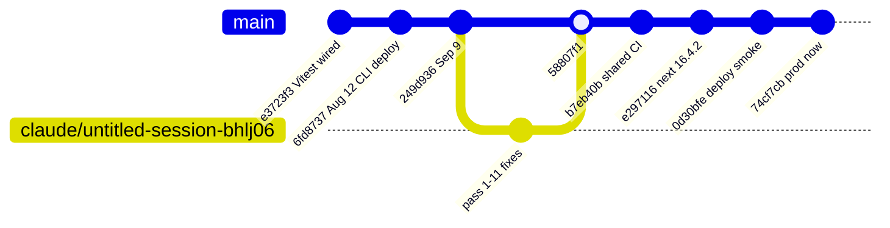
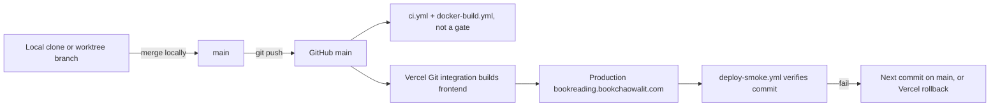

# 18 — Git and release workflow

ข้อเท็จจริงจาก `git log` และ GitHub API (2026-11-03): commit ส่วนใหญ่ push ตรงเข้า `main`; ในรอบ 90 วันมี merge commit เดียว (`58807f1`, merge branch `claude/untitled-session-bhlj06`);
ไม่มี PR ใน repo (`gh pr list --state all` ว่าง); `main` ไม่มี branch protection / ruleset; ไม่มี git tag `v*` ที่ใช้ release

Sources: `git log --since="90 days ago"`, `git log --merges`, `gh pr list -R bookchaowalit-website/content-bookreading --state all`,
`gh api repos/bookchaowalit-website/content-bookreading/branches/main/protection` (404), `.github/workflows/ci.yml`, `.github/workflows/docker-build.yml` (tags `v*`),
`.github/workflows/deploy-smoke.yml`, `specs/README.md` (SDD/TDD per spec), `RUNBOOK.md`

## Conventions ที่เห็น

- Conventional Commits (`fix(...)`, `feat(...)`, `test(...)`, `ci:`, `docs:`) และ test-first คู่ red → green (เช่น `77d6f45` test red → `d53d2a5` feat; `a799f77` → `209d57a`) ตาม ADR-0004 ของ owner ที่ `specs/README.md` อ้าง
- `docker-build.yml` รองรับ semver tag `v*` แต่ไม่มี tag ใน repo — `README.md` บอก "Version: 3.0.0" โดยไม่มี tag คู่
- ไม่มี CHANGELOG

## Open questions

- ต้องการ required checks บน `main` ก่อน Vercel deploy หรือไม่
- จะใช้ tag/release สำหรับ backend images เมื่อมี host จริงหรือไม่
