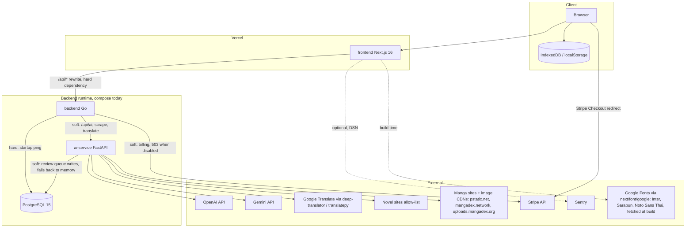

# 19 — Service dependency map (runtime)

Sources: `frontend/next.config.ts`, `frontend/src/lib/sentry.ts`, `frontend/src/app/layout.tsx`, `backend/cmd/main.go` (`db.Ping` fatal), `backend/internal/delivery/http/server.go`,
`backend/internal/delivery/http/billing_plans.go`, `backend/internal/infrastructure/aiservice/client.go`, `ai-service/main.py` (DB try / in-memory fallback),
`ai-service/agentic_translator.py`, `ai-service/url_safety.py`, `ai-service/site_routing.py`, `docker-compose.yml` (`depends_on`)

## ความหนักเบาของ dependency

| From → To | ถ้าล่ม | หลักฐาน |
|---|---|---|
| frontend → backend | ทุกหน้าที่ใช้ข้อมูลพัง (สถานะ production วันนี้: 502) | `next.config.ts`, ผล curl 2026-11-03 |
| backend → Postgres | backend ไม่ start (`log.Fatalf`); `/api/ready` 503 | `cmd/main.go`, `server.go` |
| backend → ai-service | `/api/ai/*` 502 "AI service unavailable"; scrape/translate ใน usecase error | `ai_proxy_handler.go` |
| backend → Stripe | checkout 503 เมื่อ billing ปิด; error 500 เมื่อ API fail | `payment_handler.go` |
| ai-service → Postgres | review ใช้ in-memory แทน (print warning) | `ai-service/main.py` |
| ai-service → OpenAI/Gemini | `/translate/agentic` 500; reader ใช้ Google ถ้าไม่มี key | `ai-service/main.py`, `reader/page.tsx` |
| compose start order | postgres healthy → backend, ai-service; frontend หลัง backend | `docker-compose.yml` |

## Open questions

- เมื่อ backend ขึ้น production จะวาง ai-service ในเครือข่ายเดียวกับ backend (private) หรือผ่าน public URL + `AI_SERVICE_TOKEN`
