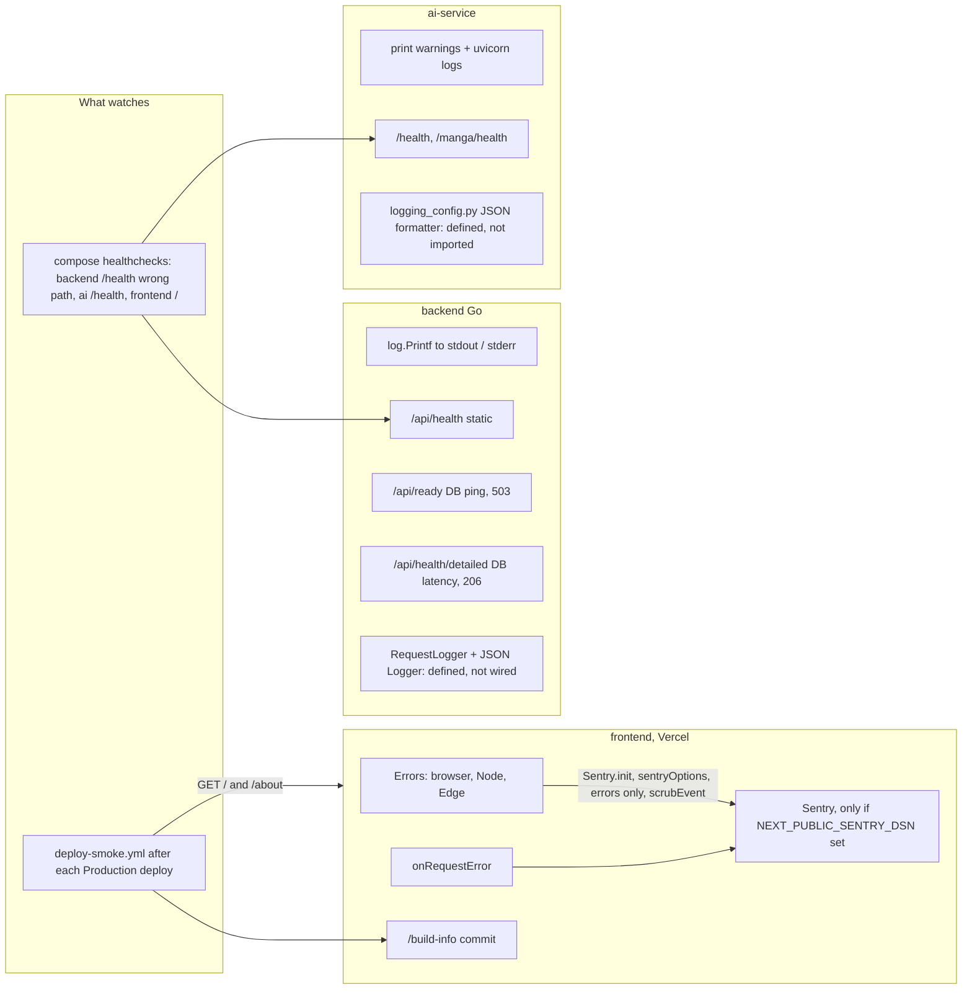

# 20 — Observability

สัญญาณที่มีโค้ดส่งจริง และสิ่งที่ "มีโค้ดแต่ไม่ได้ต่อ"

Sources: `frontend/src/instrumentation.ts`, `frontend/src/instrumentation-client.ts`, `frontend/src/lib/sentry.ts`, `frontend/src/app/build-info/route.ts`,
`backend/internal/delivery/http/server.go` (health routes), `backend/internal/middleware/logging.go`, `backend/internal/logging/logger.go`, `ai-service/main.py` (`/health`, `print`),
`ai-service/logging_config.py`, `.github/workflows/deploy-smoke.yml`, `scripts/deploy-smoke.sh`, `docker-compose.yml` (healthcheck)

## สิ่งที่ถูกเฝ้าดูจริง

| Signal | ใครดู | Alert |
|---|---|---|
| Production commit + หน้า `/`, `/about` | `deploy-smoke.yml` (ต่อ deploy เท่านั้น ไม่ใช่ periodic) | GitHub Actions failure notification (ค่า default ของ GitHub) |
| Frontend errors | Sentry (ถ้า DSN ตั้ง) | ไม่พบ alert rule ใน repo |
| Backend / ai-service health | compose healthcheck (local) | ไม่มี |
| Logs | stdout ของ container | ไม่มี aggregation |

## Gaps

- `middleware.RequestLogger` และ `logging.NewLogger` ไม่ถูกเรียกที่ใดนอกไฟล์ตัวเอง → ไม่มี access log แบบ structured
- `ai-service/logging_config.py` ไม่ถูก import → log ของ ai-service ไม่ใช่ JSON
- Sentry มีเฉพาะ frontend; backend และ ai-service ไม่มี SDK
- `/api/health` ตอบ healthy โดยไม่เช็คอะไร; compose ใช้ path ผิด (`/health`)
- `KPI-PLAN.md` KPI-G-01 (errors per 1,000 sessions) ไม่มีแหล่ง session

## Open questions

- `bookreading.bookchaowalit.com` อยู่ใน uptime monitor ของ owner (นอก repo) หรือไม่ — ไม่มีอ้างอิงใน repo นี้
- `NEXT_PUBLIC_SENTRY_DSN` ตั้งบน Vercel แล้วหรือยัง และ Sentry project ชื่ออะไร
