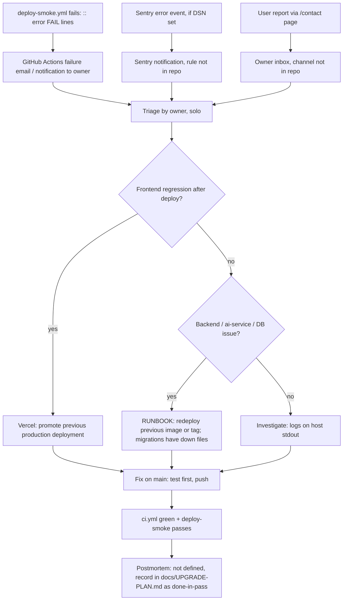

# 21 — Incident response

repo ไม่มี incident runbook เฉพาะ; `RUNBOOK.md` เป็น stub ที่บอก owner = solo operator, ไม่มี on-call, rollback = redeploy image/tag ก่อนหน้า
flow ด้านล่างใช้เฉพาะช่องทาง alert ที่พบจริง (deploy-smoke failure, Sentry) และ recovery ที่มีจริง (Vercel previous deployment, revert บน `main`)

Sources: `RUNBOOK.md` (Rollback, Owner), `.github/workflows/deploy-smoke.yml`, `scripts/deploy-smoke.sh` (`::error::` lines), `frontend/src/lib/sentry.ts`,
`frontend/src/app/contact/page.tsx`, `docs/UPGRADE-PLAN.md` (บันทึก fix เป็น pass), `database/migrations/*.down.sql`

## Severity / SLA

ไม่ได้กำหนดใน repo (ไม่มี SEV levels, ไม่มี SLA)

## ตัวอย่างจริงในประวัติ

- 2026-10-21 `b7eb40b` ทำ CI + Docker build fail (compose build ของ frontend หลังเปลี่ยนเป็น `next.config.ts`) → แก้ใน `c48e87d` ภายใน ~28 นาที (`gh run list`)
  นี่เป็น CI failure บน `main` ไม่ใช่ production incident เพราะตอนนั้น Vercel ยังไม่ต่อ Git

## Open questions

- ช่องทาง alert หลักของ owner (Telegram ใช้กับ repo อื่น) จะใช้กับ repo นี้หรือไม่
- รูปแบบ postmortem ที่ต้องการ (ไฟล์ใน `docs/` หรือ knowledge-base)
