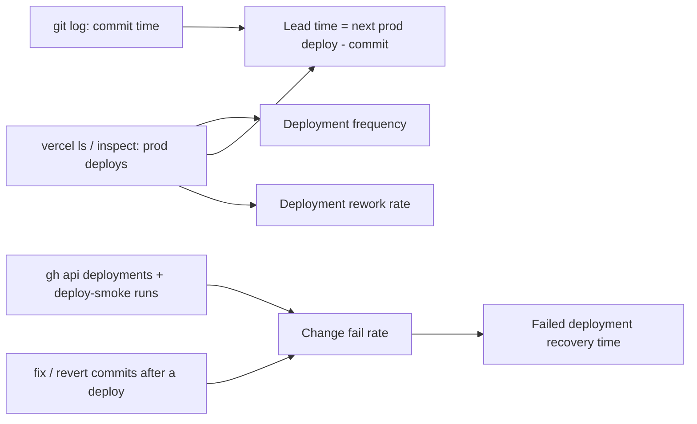

# 22 — DORA metrics

หน่วยที่วัด = **production deployment ของ frontend บน Vercel** (`bookreading-frontend`) เพราะเป็น production เดียวที่มี (backend/ai-service ไม่ถูก deploy — ดู [16-deployment.md](./16-deployment.md))
ช่วงเวลา: 90 วัน 2026-08-05 → 2026-11-03 คำนวณวันที่ 2026-11-03

## ข้อมูลดิบ

```bash
# production deployments (Vercel)
vercel ls bookreading-frontend --prod
vercel inspect <deployment-url>            # created time per deployment
# GitHub deployments + smoke results (exist only since Git integration, 2026-10-24)
gh api "repos/bookchaowalit-website/content-bookreading/deployments?per_page=100" -q '.[] | [.created_at, .environment, .sha[0:7]] | @tsv'
gh run list -R bookchaowalit-website/content-bookreading --limit 100 --created ">=2026-08-05" \
  --json workflowName,event,conclusion,headSha,createdAt
# commits
git log --since="90 days ago" --no-merges --format='%h %cI'
```

| # | Vercel created (UTC) | Commit | How | Smoke |
|---|---|---|---|---|
| 1 | 2026-08-12 10:19 | not recorded (ก่อนต่อ Git, `specs/001`: "last deployed by CLI on 2026-08-12") | CLI | — |
| 2 | 2026-10-23 04:40 | `e297116` (สันนิษฐานจากเวลา push 04:34; Vercel inspect ไม่แสดง SHA, ไม่มี GitHub deployment record) | Git? | — |
| 3 | 2026-10-24 04:56 | `0d30bfe` (GitHub deployment `7294275425`) | Git | success |
| 4 | 2026-10-24 05:20 | `0d30bfe` อีกครั้ง (status ที่สองของ deployment เดียวกัน) | redeploy | success |
| 5 | 2026-10-24 09:58 | `74cf7cb` (GitHub deployment `7297110187`) | Git | success |

## Metrics

| Metric | วิธีวัดสำหรับ repo นี้ | ค่า 90 วัน |
|---|---|---|
| Deployment frequency | จำนวน Vercel production deployment ÷ สัปดาห์ | **5 ครั้ง / 12.9 สัปดาห์ ≈ 0.39 ต่อสัปดาห์** (4 commit ที่ต่างกัน); เป็นกลุ่มก้อน: 1 ครั้งเดือน ส.ค., 4 ครั้งใน 2026-10-23…24 |
| Lead time for changes | เวลา commit (`%cI`) → production deploy ถัดไปที่รวม commit นั้น | ทั้ง 46 non-merge commit: **median 532 ชม. (~22 วัน)** เพราะงาน pass 1–11 (2026-09-30…10-01) ค้างจนต่อ Git วันที่ 10-23; เฉพาะ 5 commit หลังต่อ Git: **median 2.65 ชม.** (0.01 – 22.6 ชม.) |
| Change fail rate | deployment ที่ smoke fail หรือมี fix/revert commit ตามมาเพื่อแก้ปัญหาที่ deployment นั้นนำเข้า prod | smoke: **0 / 3** ที่มี smoke; ถ้านับ `209d57a fix(sentry)` (แก้ request_path หลุดไป Sentry ที่ deploy ไปใน #2): **1 / 4 commit-deploy = 25%** |
| Failed deployment recovery time | เวลาจาก deployment ที่ fail → deployment ที่แก้แล้ว | **คำนวณไม่ได้แบบ strict** (ไม่มี deployment fail ที่บันทึก); ถ้านับกรณี Sentry: #2 04:40 → #3 04:56 วันถัดไป ≈ **24.3 ชม.** |
| Deployment rework rate | deployment ที่ไม่ได้วางแผน / เกิดจาก incident ÷ ทั้งหมด | **1 / 5 = 20%** ถ้านับ #4 (redeploy SHA เดิม ไม่ทราบเหตุผล) — หรือ 2 / 5 ถ้านับ #3 ว่าเป็น rework เพราะพา fix Sentry ไปด้วย; เหตุผลของ #4 ต้องถาม owner |

คำนวณ lead time ด้วยสคริปต์: สำหรับแต่ละ commit หา deployment แรกที่ `created >= commit time` แล้วเอา median (`python3` บน output ของ `git log --format='%h %ct'` และเวลาจากตารางด้านบน)



Sources: `.github/workflows/deploy-smoke.yml`, `scripts/deploy-smoke.sh`, `specs/001-next16-shared-ci-sentry/spec.md` (Deploy), `git log`, `gh run list`, `gh api .../deployments`, `vercel ls/inspect`

## CI บน main (ไม่ใช่ DORA แต่เกี่ยวข้อง)

`gh run list --workflow ci.yml` 90 วัน: workflow `CI` บน push `main` = 14 run, fail 6 (2026-08-11 ×4, 09-09, 10-21) — ทุก fail เกิดก่อน Vercel ต่อ Git (2026-10-23) จึงไม่กระทบ production

## Open questions

- deployment #2 (2026-10-23) เป็น commit ไหนจริง และ #4 redeploy เพราะอะไร
- deploy ของ backend/ai-service จะนับรวมเมื่อมี host (ตอนนี้ไม่มี)
- ต้องการเก็บ DORA อัตโนมัติ (เช่น workflow ที่อ่าน `deployment_status`) หรือไม่
